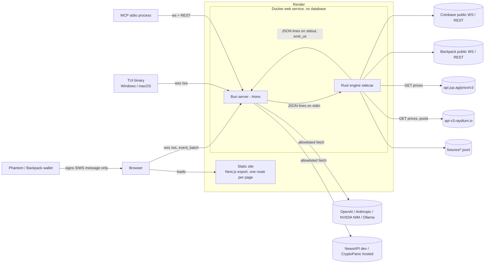
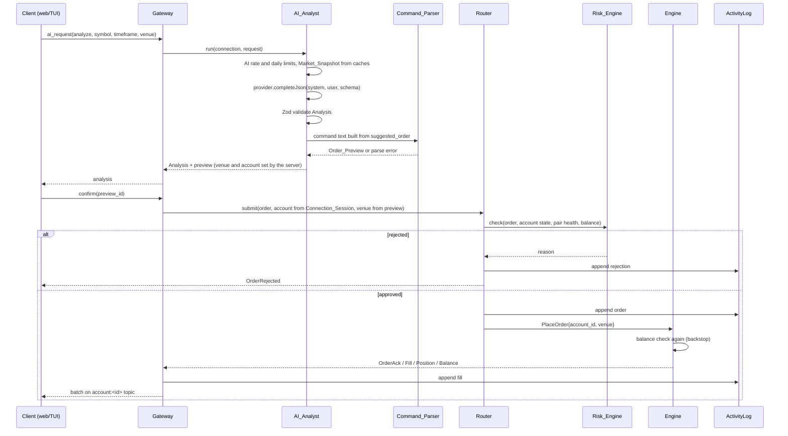
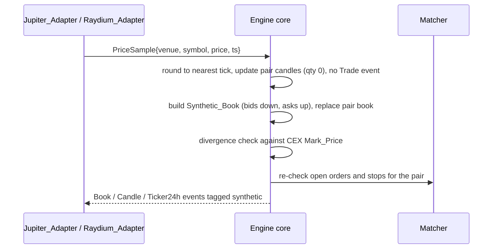

# Design Document: Oni Terminal v2

## Overview

Oni Terminal v2 extends the finished Haunted Terminal system (`.kiro/specs/haunted-terminal/`, called "HT" below) and the finished `chart-and-tape-fix` spec. It keeps HT's three rules and adds three more:

1. **One protocol definition.** Every message type lives in the Rust `protocol` crate. ts-rs generates the TypeScript types, and `bun run gen:protocol` regenerates them.
2. **One order path.** Every order, from the Web_UI, the TUI, the plain-English parser, the AI analyst, the MCP server, and the TWAP scheduler, goes through the Router and the Risk_Engine before a Command reaches the engine (HT Req 18, trading-safety rule 2).
3. **Deterministic core.** The engine core is a pure state machine driven by market-data time. Wall-clock facts (staleness, emit time) enter as input messages, never as clock reads.
4. **No storage.** Nothing is persisted. Orders, fills, and rejections live in a bounded in-memory Activity_Log, and history comes from public exchange APIs (Req 1, 2).
5. **Read-only market data.** Every outbound request passes an allowlist that names exact hosts, paths, and methods. No code path can build, sign, or send a transaction (Req 14).
6. **Models suggest, people decide.** LLM output is untrusted input that Zod validates, the Command_Parser turns into a preview, and the user confirms. This holds for all four providers and for the AI analyst (Req 5, trading-safety rule 4).

Version 2 makes six changes, each covered by a section below: no database (Req 1, 2), pluggable AI providers and an AI analyst (Req 3 to 7), ten symbols on four venues with a simulated DEX book (Req 8 to 18), news (Req 19, 20), the new web and TUI layouts (Req 21 to 32), and latency work (Req 33 to 35). Paper balance and the `insufficient_balance` rule (Req 16) touch the engine, the Risk_Engine, and the order ticket.

### Facts this design relies on

These facts were checked on the dates shown. A fact marked **not verified** could not be confirmed from a primary source. Content from web pages was rephrased for compliance with licensing restrictions.

**Jupiter Price API v3** ([API reference](https://developers.jup.ag/docs/api-reference/price), [rate limits](https://developers.jup.ag/docs/portal/rate-limits)):

- `GET https://api.jup.ag/price/v3?ids=<mint>,<mint>,...` returns USD prices for up to 50 mints in one request. Tokens without a reliable price are left out of the response.
- Each entry has `usdPrice`, `liquidity` (USD across all pools), `priceChange24h` (percent, nullable), `blockId`, `decimals`, and `createdAt`. The API key is an optional `x-api-key` header.
- Keyless access is limited to 0.5 requests per second (30 per minute). A free key gives 1 per second, and the Developer tier 10 per second. Limits use a 60-second sliding window. Responses carry `x-ratelimit-remaining`, `x-ratelimit-current`, and `x-ratelimit-reset` (a Unix timestamp in seconds). A 429 has no extra lockout.
- A live call on 2026-11-20 returned prices for SOL, JUP, WIF, BONK, Wormhole-wrapped BTC (`3NZ9...`), and Wormhole-wrapped ETH (`7vfC...`), and returned nothing for the BNB mint that was tried.

**Raydium API v3** ([REST surface](https://docs.raydium.io/sdk-api/rest-api), [mint prices](https://docs.raydium.io/api-reference/api-v3-endpoints/mint/get-mint-prices), [pools by mint](https://docs.raydium.io/api-reference/api-v3-endpoints/pools/get-pools-by-token-mint)):

- `GET https://api-v3.raydium.io/mint/price?mints=<a>,<b>,...` returns `{ id, success, data: { <mint>: "<usd price string>" } }`, cached 5 seconds at the edge. The `mints` parameter is optional in the schema and comma separated.
- `GET https://api-v3.raydium.io/pools/info/mint?mint1=<mint>&poolType=all&poolSortField=liquidity&sortType=desc&pageSize=1&page=1` returns `data.data[]` pool entries with `tvl`, cached 60 seconds. `poolType`, `poolSortField`, `sortType`, `pageSize` (1 to 1000), and `page` are required.
- The REST page says all hosts sit behind Cloudflare with progressive per-IP rate limiting, that bursts return HTTP 429 with `Retry-After`, and that `GET /mint/price` is fine for UI rendering but should not be looped in a bot. The numeric limits for `api-v3` are not published on the pages read. This design polls prices every 3 seconds and pool liquidity once a minute per symbol.
- `transaction-v1.raydium.io` is Raydium's transaction-building host ([Trade API](https://docs.raydium.io/sdk-api/trade-api)). It also serves `GET /compute/swap-base-in` quotes (120 requests per minute per IP). The price API is enough for this design, so the host is **not** used and is not in the allowlist.
- A live call on 2026-11-20 returned prices for SOL, JUP, WIF, BONK, and the same wrapped BTC and ETH mints as Jupiter, within 0.4% of Jupiter's values.

**Venue symbol facts** (live calls on 2026-11-20 to the public [Backpack market endpoint](https://api.backpack.exchange/api/v1/market?symbol=BNB_USDC) and the public [Coinbase products endpoint](https://api.exchange.coinbase.com/products/BNB-USD)):

- Backpack lists spot `<BASE>_USDC` markets for BNB, XRP, DOGE, JUP, WIF, BONK, and PEPE. Coinbase lists BNB, XRP, DOGE, WIF, BONK, and PEPE against USD, and reports `JUP-USD` as `delisted`.
- Reference prices that day: BTC about 59,400, ETH about 1,640, SOL about 68.7, BNB 547, XRP 0.913, DOGE 0.0538, JUP 0.221, WIF 0.12, BONK 0.00000207, PEPE 0.00000339 (Coinbase, Jupiter, and Raydium tickers).
- PEPE has a canonical Solana mint since a Wormhole launch ([Solana Compass](https://solanacompass.com/news/pepe-lands-on-solana-as-a-canonical-spl-token-via-wormhole-ntt-hits-40m-volume-in-24-hours)). The address is **not verified** here. A guessed PEPE mint returned a different token priced 47 times too high, which is why mints come only from a committed, tested map and why the divergence guard exists.

**LLM providers** (details in "LLM provider abstraction"): OpenAI Responses API ([models](https://developers.openai.com/api/docs/models), [structured outputs](https://developers.openai.com/api/docs/guides/structured-outputs)), Anthropic Messages API ([models](https://platform.claude.com/docs/en/about-claude/models/overview), [structured outputs](https://platform.claude.com/docs/en/build-with-claude/structured-outputs), [forced tool use limits](https://platform.claude.com/docs/en/agents-and-tools/tool-use/define-tools)), NVIDIA NIM ([structured generation](https://archive.docs.nvidia.com/nim/large-language-models/1.13.0/structured-generation.html)), and Ollama ([structured outputs](https://docs.ollama.com/capabilities/structured-outputs), [list models](https://docs.ollama.com/api/tags)).

**News**: NewsAPI's [pricing page](https://newsapi.org/pricing) says the free Developer plan is for development and testing only and not for staging or production, even internally. Third-party summaries ([Airbyte](https://airbyte.com/top-etl-tools-for-sources/news-api)) add 100 requests per day and a 24-hour article delay. CryptoPanic's own documentation could not be fetched. A third-party SDK README ([cryptopanic-go](https://github.com/tigusigalpa/cryptopanic-go)) gives the path form `/api/<plan>/v2/posts/` with an `auth_token` query parameter, and says the free Developer plan was discontinued. That claim is **not verified** against CryptoPanic.

### Decision summary

| ID | Decision | Rejected alternatives |
|---|---|---|
| D1 | Keep the OpenAI Responses API that `server/src/llm/openai.ts` already uses, and add a generic `completeJson` method to the provider interface | Switch to Chat Completions (requirement text said so; the code, tests, and OpenAI's current docs favour Responses, so Req 3.3 was amended) |
| D2 | Anthropic structured output through `output_config.format`, not a forced tool call | Forced `tool_choice` (returns HTTP 400 on Opus 5.5, Sonnet 5.5, and Fable 5.2; Req 3.4 was amended) |
| D3 | NVIDIA NIM through `nvext.guided_json` plus `response_format: json_object`, with one same-provider retry without `nvext` | `response_format: json_schema` only (NIM documents `guided_json` as the recommended path) |
| D4 | Raydium price and pool data only, from `api-v3.raydium.io`; the quote host is dropped | Keep `compute/swap-base-in` for quotes (it lives on the transaction-building host and adds no data the price API lacks) |
| D5 | Engine owns all venue adapters, including Jupiter and Raydium polling | Poll DEX prices in the Server and forward them (would split market data across two processes and break replay determinism) |
| D6 | Staleness enters the pure core as a `Clock` input message; replay venue is exempt | Read the wall clock inside the core (breaks determinism) |
| D7 | One Reference_Venue per symbol, chosen by a fixed priority; Mark_Price comes from it | Average the venues (hides a bad feed) or use the Active_Venue (equity would change when the user switches chips) |
| D8 | Balance model: Free_Balance = Paper_Balance − 2 × Short_Basis − Reserved_Balance, checked in the Risk_Engine and again in the engine | Margin ratios and liquidation (no requirement; large scope); cash-only with shorting banned (current code already allows shorts) |
| D9 | Ticker24h from the 1h bar series, 24 bars wide | A 1,440-bar 1m ring (needs 1,440 bars of REST backfill per pair) |
| D10 | Server-side batching with a 10 ms Flush_Window and per-key coalescing; Candle updates coalesce by bar start time | Client-side throttling only (leaves the wire flooded); coalescing Candle by (symbol, venue, timeframe) only (drops the final update of a closed bar) |
| D11 | Router-owned TWAP scheduler with an injectable clock; children are ordinary market orders | An engine-side TWAP order type (moves scheduling and account-change rules into the engine, which has no sessions) |
| D12 | A scan counts as one AI rate-limit unit and N daily-cap units | Count each scanned symbol against the per-minute rate (the default of 6 per minute would make every 10-symbol scan impossible) |
| D13 | Static export with one route per page, client-side navigation inside one root layout | A single-page app with a hash router (breaks Req 21.3 direct URLs) |
| D14 | Instrument_Table exported to `shared/protocol/instruments.json` by the protocol crate | Keep two hand-written copies (HT's `server/src/instruments.ts` already says "keep in step") |

## Architecture



There is no database box. `render.yaml` declares one web service and one static site.

### Order and analysis flow



The AI path never touches the Router until the user confirms. No box in the left half of this diagram holds an engine sender.

### DEX price to paper fill



## Repository Layout

Changes only. Everything else is as in HT.

```
trade/
├─ .kiro/                        steering/ amended, specs/oni-terminal-v2/
├─ rust/crates/
│  ├─ protocol/                  + Venue variants, WireEvent, Balance, Ticker24h, VenueStatus, PairStatus, ReferenceVenue,
│  │                               H4 timeframe, ten-symbol Instrument_Table, instruments.json export
│  ├─ engine/                    + per-(venue, symbol) state, DEX adapters, Synthetic_Book, balance, ticker, allowlist
│  └─ tui/                       + panels [1]-[8], header, venue and provider pickers, news, Copilot
├─ server/
│  ├─ scripts/start.ts           now: validate config, start the server (no Migration step)
│  ├─ scripts/bench-latency.ts   new
│  ├─ prisma/, prisma.config.ts  DELETED
│  └─ src/
│     ├─ journal/                DELETED (replaced by activity/)
│     ├─ generated/              DELETED
│     ├─ net/                    allowlist.ts, http.ts, redact.ts
│     ├─ activity/               log.ts, routes.ts
│     ├─ llm/                    provider.ts (generic), openai.ts, anthropic.ts, nvidia.ts, ollama.ts, registry.ts, limits.ts, schema.ts, parser.ts
│     ├─ ai/                     snapshot.ts, prompt.ts, analysis.ts, analyst.ts, scan.ts
│     ├─ news/                   provider.ts, newsapi.ts, cryptopanic.ts, cache.ts, symbols.ts
│     ├─ gateway/                + batcher.ts, coalesce.ts
│     ├─ metrics/                histogram.ts
│     ├─ risk/                   + guards.ts, balance.ts
│     └─ router/                 twap.ts (the Router itself stays at src/router.ts)
├─ web/app/                      one folder per page: trade/, dashboard/, markets/, strategies/, copilot/, backtest/, portfolio/, logs/, settings/, pair/
├─ shared/
│  ├─ protocol/                  generated TS + instruments.json (generated)
│  ├─ balance-vectors.json       golden cases for Required_Funds, written by a Rust test, read by both test suites
│  └─ keymap.json                + per-client key lists
├─ fixtures/demo.jsonl           regenerated for ten symbols
├─ Dockerfile, render.yaml       no database
└─ .github/workflows/ci.yml      no postgres jobs; + latency job
```

Root `package.json` keeps Bun workspaces `server`, `web`, `shared`. `bun run check` runs `cargo fmt --check`, `cargo clippy -D warnings`, `cargo test`, then `tsc --noEmit` per package and `bun test`. It no longer runs `prisma generate`, and needs no database, key, or network (Req 1.8, 36.6).

## Components and Interfaces

### 1. Protocol crate (`rust/crates/protocol`)

Protocol version becomes 3. The tables list every change, so that the Rust, Zod, and TypeScript sides can be checked against one list. Wire names are snake_case, as in HT.

#### Types

| Type | Change |
|---|---|
| `Venue` | Variants `coinbase`, `backpack`, `jupiter`, `raydium`, `replay`. `Venue::kind() -> VenueKind { Cex, Dex }` (replay is `cex`). `Venue::LIVE: [Venue; 4]` |
| `Timeframe` | Adds `4h` (`H4`). Order is `1m, 5m, 15m, 1h, 4h, 1d` |
| `Instrument` | Adds `reference_price: &'static str` (a decimal string, used by the table test), `venues: &'static [Venue]` (where the symbol is listed), and ten entries |
| `InstrumentInfo` | Adds `venues: Vec<Venue>` |
| `VenueStatusKind` | `connected`, `connecting`, `stale`, `down`, `disabled` |
| `PairHealth` | `ok`, `stale`, `suspect` |
| `Ticker` | `{ open, high, low, last: Price, volume: Option<Qty>, change_bps: i32, partial: bool }` |
| `WireEvent` | `{ #[serde(flatten)] event: Event, emit_us: Option<u64> }`. The runtime wraps every event when it writes the line. The core never sees it |
| `CopilotAction` | `analyze`, `ask`, `create_strategy`, `scan` |
| `AnalysisBias` | `long`, `short`, `neutral` |
| `ProviderId` | `openai`, `anthropic`, `nvidia`, `ollama` |
| `NewsItem` | `{ id, title, source, url, published_at, symbols: Vec<String> }` |
| `TwapStatus` | `active`, `done`, `canceled` |

#### Commands (server to engine)

| Command | Change |
|---|---|
| `Subscribe`, `Unsubscribe` | Add `venue`. The engine streams candles, indicators, book, and trades for that (venue, symbol) |
| `SubscribeTicker`, `UnsubscribeTicker` | New. `{ symbol, venue }`. The watchlist uses them without a candle subscription |
| `PlaceOrder` | Adds `venue` |
| `Cancel`, `CancelAll`, `ResetAccount`, `StartReplay`, `Ping` | Unchanged |

#### Events (engine to server)

| Event | Change |
|---|---|
| `Candle`, `Trade`, `Book`, `Indicators` | Add `venue`. `Book` and `Trade` add `synthetic: bool` (true for DEX data) |
| `Ticker24h` | New: `{ symbol, venue, ticker: Ticker, synthetic: bool, ts }` |
| `VenueStatus` | New: `{ venue, status: VenueStatusKind, ts }`, emitted on every change |
| `PairStatus` | New: `{ venue, symbol, health: PairHealth, ts }`, emitted on every change (Req 9.7, 14.6) |
| `ReferenceVenue` | New: `{ symbol, venue: Option<Venue> }`, emitted when the Reference_Venue of a symbol changes (Req 9.11) |
| `OrderAck`, `OrderRejected`, `Fill` | Add `venue` |
| `Position` | Unchanged fields. Unrealized P&L uses the Mark_Price |
| `Balance` | New: `{ account_id, paper_balance: Money, free_balance: Money, equity: Money, ts }` |
| `OrderRejected.reason` | A string, as today. New values: `insufficient_balance`, `venue_unavailable`, `stale_market_data`, `price_deviation` |

#### Client and server messages

| Message | Change |
|---|---|
| `ClientMessage::Subscribe`, `Unsubscribe` | Add `venue` |
| `ClientMessage::SubscribeTicker`, `UnsubscribeTicker` | New, same shape as the engine commands |
| `ClientMessage::CommandText` | Adds `venue: Venue` (the Active_Venue). The server validates it against the Hello venue list |
| `ClientMessage::CancelTwap { request_id, twap_id }` | New (Req 17.7) |
| `ClientMessage::SetProvider { provider }` | New (Req 4.2) |
| `ClientMessage::AiRequest { request_id, action, text, symbol, timeframe, venue }` | New. `Place trade` is not an action here: the client sends `CommandText` with a `?` prefix (Req 7.4) |
| `ClientMessage::AiCancel { request_id }` | New (Req 7.8) |
| `ClientMessage::SubscribeNews`, `UnsubscribeNews` | New (Req 19.10) |
| `ServerMessage::Hello` | Adds `live_venues: Vec<Venue>`, `venue_status: Vec<{ venue, status }>`, `starting_balance`, and `venue` is replaced by `live_venues`. `instruments` now lists ten symbols with `venues` |
| `ServerMessage::EventBatch { events: Vec<WireEvent> }` | New. The server may send it instead of several `Event` messages (Req 34.1) |
| `ServerMessage::Providers { available: Vec<ProviderInfo>, default, selected }` | New. `ProviderInfo` is `{ id, model, reason: Option<String> }` and holds no key, base URL, or credential (Req 4.1) |
| `ServerMessage::Analysis { request_id, provider, model, analysis, preview: Option<OrderPreview>, preview_error: Option<{ message, position }> }` | New (Req 5.9) |
| `ServerMessage::ScanResult { request_id, items: Vec<ScanItem> }` | New, ranked by confidence descending (Req 7.5) |
| `ServerMessage::StrategyDraft { request_id, text }` | New. The text always starts with "draft, not executed" (Req 7.6) |
| `ServerMessage::AiError { request_id, reason, message }` | New. `reason` is `ai_disabled`, `ai_rate_limit`, `ai_daily_cap`, `provider_error`, `validation_error`, `timeout`, or `canceled` |
| `ServerMessage::News { available, items, updated_at }` | New (Req 19.10, 19.13) |
| `ServerMessage::Twap { twap_id, symbol, side, venue, slices, sent, status, reason }` | New (Req 17.9) |
| `PreviewAction` | Adds `venue` to `Place` and a new `Twap { symbol, side, venue, total_qty, slices, interval_s }` |
| `NoticeKind` | Adds `slow_client`, `ai_disabled` (renames `llm_disabled`), and `provider_changed` |

#### Generation and mirrors

- ts-rs exports the new types to `shared/protocol/` through `#[ts(export, export_to = crate::TS_EXPORT_DIR)]`. `bun run gen:protocol` runs the export tests and regenerates everything. `WireEvent` uses `#[ts(flatten)]` for the inner event. Generated files are never edited by hand (tech.md).
- A new protocol-crate test also writes `shared/protocol/instruments.json` (symbol, short, decimals, reference price, listed venues). `server/src/instruments.ts` becomes a thin loader for that file, so the Rust table and the server cannot drift (D14).
- `server/src/protocol.ts` keeps hand-written Zod mirrors. Each mirror is declared `satisfies z.ZodType<Generated>`, so a protocol change that is not mirrored fails `tsc`.
- Wire example: `{"type":"book","venue":"jupiter","symbol":"SOL-USD","bids":[...],"asks":[...],"spread":"7","imbalance_bps":0,"synthetic":true,"ts":1733200000000,"emit_us":1733200000123456}`.

### 2. Engine (`rust/crates/engine`)

```
engine/src/
├─ main.rs          clap: `engine run --mode replay|live --venues coinbase,backpack,jupiter,raydium --fee-bps 5
│                   --starting-balance 100000 --dex-levels 10 --dex-spread-bps 10 --dex-step-bps 5
│                   --dex-level-notional 25000 --dex-max-deviation-pct 5 --balance-slippage-bps 100
│                   --jupiter-poll-ms 1000 --raydium-poll-ms 3000 --fixtures <dir>`, `engine record`, `engine synth`
├─ runtime.rs       tokio wiring: stdin reader, stdout writer (flush per line, adds emit_us), feed tasks, 1 s clock + heartbeat
├─ core.rs          Engine state machine (pure)
├─ pair.rs          PairState per (Venue, symbol): book, last price and time, candles, health
├─ venues.rs        venue status table, Reference_Venue selection, "N of M connected" (pure)
├─ dex.rs           build_synthetic_book (pure)
├─ balance.rs       required_funds, free_balance, equity (pure)
├─ ticker.rs        Ticker24h from the 1h bar series (pure)
├─ account.rs       + paper_balance, short basis, reserved funds
├─ matcher.rs       venue-aware: open orders keyed by (venue, symbol)
├─ candles.rs       + 4h from 1h
├─ book.rs, indicators.rs   unchanged logic
└─ feed/
   ├─ mod.rs        MarketMsg (+ PriceSample, Status, Clock; every market variant has a venue)
   ├─ allowlist.rs  exact hosts and paths for the engine's HTTP and WebSocket clients
   ├─ http.rs       reqwest wrapper that refuses non-allowlisted URLs; marks keys as sensitive headers
   ├─ venue.rs      Venue_Symbol_Map: per venue symbol or mint, decimal conversion, drop counter
   ├─ live.rs       starts one task per venue in LIVE_VENUES, merges messages, owns backoff
   ├─ coinbase.rs, backpack.rs          ten symbols, same logic as HT
   ├─ jupiter.rs, jupiter_parse.rs      Jupiter_Adapter
   ├─ raydium.rs, raydium_parse.rs      Raydium_Adapter
   ├─ replay.rs, fixture.rs, synth.rs   replay for ten symbols; fixture lines carry no venue and are tagged `replay` on read
   └─ backfill.rs   REST candle history (Backpack klines, Coinbase candles); 4h is built from 1h
```

#### Instrument_Table (Req 8)

Ten entries. The table test checks three rules for every row: tick ≤ 0.02% of `reference_price`, lot no coarser than the finest quantity increment on any listing venue, and `price_decimals + qty_decimals ≤ 10` (Money's scale, so the product of one tick and one lot is at least one Money unit). BTC, ETH, and SOL keep their HT decimals, so existing fixtures, tests, and fills stay valid.

| Symbol | Reference price | Price decimals | Qty decimals | Tick as % of price | Backpack (tick / step) | Coinbase (quote / base increment) | DEX mint |
|---|---|---|---|---|---|---|---|
| BTC-USD | 59,400 | 2 | 8 | 0.00002% | `BTC_USDC` | `BTC-USD` | `3NZ9JMVBmGAqocybic2c7LQCJScmgsAZ6vQqTDzcqmJh` |
| ETH-USD | 1,640 | 2 | 8 | 0.0006% | `ETH_USDC` | `ETH-USD` | `7vfCXTUXx5WJV5JADk17DUJ4ksgau7utNKj4b963voxs` |
| SOL-USD | 68.7 | 2 | 8 | 0.0146% | `SOL_USDC` | `SOL-USD` | `So11111111111111111111111111111111111111112` |
| BNB-USD | 547 | 2 | 8 | 0.0018% | `BNB_USDC` (0.01 / 0.001) | `BNB-USD` (0.01 / 0.00001) | not listed |
| XRP-USD | 0.913 | 4 | 6 | 0.0110% | `XRP_USDC` (0.0001 / 0.1) | `XRP-USD` (0.0001 / 0.000001) | not listed |
| DOGE-USD | 0.0538 | 6 | 4 | 0.0019% | `DOGE_USDC` (0.00001 / 1) | `DOGE-USD` (0.00001 / 0.1) | not listed |
| JUP-USD | 0.221 | 6 | 4 | 0.0005% | `JUP_USDC` (0.00001 / 0.1) | not listed (delisted) | `JUPyiwrYJFskUPiHa7hkeR8VUtAeFoSYbKedZNsDvCN` |
| WIF-USD | 0.12 | 6 | 4 | 0.0008% | `WIF_USDC` (0.00001 / 0.1) | `WIF-USD` (0.00001 / 0.01) | `EKpQGSJtjMFqKZ9KQanSqYXRcF8fBopzLHYxdM65zcjm` |
| BONK-USD | 0.00000207 | 10 | 0 | 0.0048% | `BONK_USDC` (1e-9 / 10000) | `BONK-USD` (1e-8 / 1) | `DezXAZ8z7PnrnRJjz3wXBoRgixCa6xjnB7YaB1pPB263` |
| PEPE-USD | 0.00000339 | 10 | 0 | 0.0029% | `PEPE_USDC` (1e-9 / 10000) | `PEPE-USD` (1e-8 / 1) | not listed until a mint is verified |

- **Why the requirement changed from 0.01% to 0.02%.** XRP needs a lot of 0.000001 (Coinbase's base increment), which leaves four price decimals under the 10-decimal Money limit. A 0.0001 tick is 0.011% of 0.913. SOL's HT tick of 0.01 is 0.0146% of 68.7. A lot coarser than Coinbase's increment would drop real trades under the "never round a CEX value" rule. Req 8.2 now says 0.02% and states the other two rules.
- **Venue tick and step compatibility.** Every internal tick and lot divides the venue's own increment (checked in the table above). The startup log of Req 8.7 reports any breakage.
- **Venue_Symbol_Map.** `feed/venue.rs` holds, per symbol, the Backpack symbol, the Coinbase product (or `None`), and the Jupiter and Raydium mint (or `None`). BNB, XRP, DOGE, and PEPE are marked not listed on the DEX Venues because no mint for them was verified. The map has a test that every mint string is the one committed in the table above. The Server and clients never supply a mint (Req 8.5).
- **Verification step for the build task.** A recorded-response fixture per DEX adapter proves that the six listed mints return a price, and a test compares each recorded DEX price to the recorded CEX price within 5%.

#### Per-pair state and Reference_Venue (Req 9, 15)

- The core keeps `BTreeMap<(Venue, String), PairState>`. A `PairState` holds the `Order_Book`, last price and its time, the `Candle_Builder` rings, subscription flags, and `PairHealth`. Nothing is shared between venues (Req 9.4).
- `venues.rs` implements `reference_venue(symbol, statuses)`: the first venue in the order `backpack, coinbase, raydium, jupiter, replay` whose status is `connected` and that lists the symbol. The result is recomputed when a status changes, and `ReferenceVenue` is emitted when it changes.
- Mark_Price of a symbol is the last price of its reference pair. Unrealized P&L, Equity, and the Position events use it (Req 15.7). A trade or sample on a non-reference pair does not move the Mark.
- The Position event for an account is emitted when the reference pair's last price changes and the account holds the symbol, in `AccountId` order, as in HT. A `Balance` event follows when Equity moved by at least 0.01 USD since the last one for that account.

#### Live feed and statuses (Req 9)

- `feed/live.rs` starts one tokio task per venue in `--venues`. Each task owns its backoff (500 ms doubling to 30 s) and sends `MarketMsg` values and `Status` messages into one channel. A failure in one task changes only that venue's status (Req 9.6).
- `Status` changes follow `connecting → connected → stale → connected` and `down` on failure. `disabled` is used only for a venue not named in `--venues`, so the Web_UI can show its chip as disabled.
- **Staleness (D6).** The runtime sends `MarketMsg::Clock { ts }` once a second. The core compares `ts` with each pair's last message time. A CEX pair is stale after 15 s and a DEX pair after 20 s (Req 9.7). A venue is `stale` when all its subscribed pairs are stale. In replay mode no `Clock` is sent for the `replay` venue, so replay never goes stale.
- In replay mode the only venue is `replay`, and all ten symbols are served from the fixture (Req 9.5).

#### Jupiter_Adapter (Req 10)

- One task. Each cycle sends one `GET https://api.jup.ag/price/v3?ids=<six mints>` through `feed/http.rs`. The request goes to no other Jupiter URL, and the allowlist has no swap, order, or execute path.
- **Interval.** Keyless: at least 2000 ms (0.5 requests per second). With a key: `JUPITER_POLL_MS`, default 1000, minimum 500. A free key allows 1 request per second, so values under 1000 only make sense on a paid plan. The adapter also reads `x-ratelimit-remaining`. When it is 1 or less, the next request waits until `x-ratelimit-reset` (Req 10.5 asks for `Retry-After`, the docs name the `x-ratelimit-*` headers, and the adapter honours both).
- **429.** Wait the `Retry-After` seconds, else until `x-ratelimit-reset`, else the current backoff delay (500 ms doubling to 30 s).
- **Key.** `JUPITER_API_KEY` reaches the engine as an environment variable set by `Bun.spawn`, never as an argument. The reqwest header is marked sensitive, so it does not appear in logs or debug output (Req 10.7).
- **Parsing.** A typed serde struct for `{ <mint>: { usdPrice, liquidity, priceChange24h } }`. A price that is not a positive finite number is dropped and counted. `usdPrice × 10^price_decimals` is rounded to the nearest tick. A sample carries `change24h_bps` from `priceChange24h` when present.
- Mints missing from a response (no reliable price) leave that pair untouched. After the staleness limit the pair goes `stale`.

#### Raydium_Adapter (Req 11)

- Prices: `GET https://api-v3.raydium.io/mint/price?mints=<mints>` every `RAYDIUM_POLL_MS` (default 3000). Values are decimal strings and go through the exact decimal-to-tick converter with nearest rounding. The edge cache lasts 5 seconds, so a poll faster than 5 s often sees the same value. Samples with an unchanged price still refresh the pair's time.
- Liquidity: one `GET /pools/info/mint?mint1=<mint>&poolType=all&poolSortField=liquidity&sortType=desc&pageSize=1&page=1` per symbol, staggered across 60 s, reads `data.data[0].tvl`. The edge cache lasts 60 s. On failure the book keeps the previous or default level size (Req 11.2).
- A response with a `transaction` field anywhere in its JSON is discarded, the venue goes `down`, and the venue name is logged (Req 11.5). The envelope is `{ id, success, data }`; `success: false` is an error.
- 429: exponential backoff from 1 s to 30 s (Req 11.7).

#### Synthetic_Book (Req 12)

`dex::build_synthetic_book(sample: Price, p: DexParams, inst: &Instrument, notional: Money) -> (Vec<Level>, Vec<Level>)` is pure and integer-only (`i128`). Let `S` be `DEX_SPREAD_BPS`, `T` be `DEX_STEP_BPS`, and `k = 0..DEX_LEVELS−1`.

- `bid_k = floor(sample × (20000 − S − 2·k·T) / 20000)`, and `ask_k = ceil(sample × (20000 + S + 2·k·T) / 20000)`.
- Strictness: if `bid_k ≥ bid_{k−1}` set `bid_k = bid_{k−1} − 1`, and if `ask_k ≤ ask_{k−1}` set `ask_k = ask_{k−1} + 1`. Levels with a price below 1 tick stop the bid side early. If `ask_0 ≤ bid_0` the ask is raised to `bid_0 + 1`. `S` is at least 1 (config rule).
- Level quantity: `max(1, floor(level_notional / notional_of_one_lot_at(level price)))` lots, so every quantity is above zero (Req 12.10).
- `level_notional` is `DEX_LEVEL_NOTIONAL` (default 25,000 USD). For Raydium it is `clamp(tvl × 0.005, 500, DEX_LEVEL_NOTIONAL)` USD when the liquidity read succeeded (Req 12.4).
- **Direction.** Because bids are rounded down and asks up, every ask is at least the sample and every bid at most the sample, so a buy's average fill is at least the sample price and a sell's at most (Req 12.12).
- The Matcher fills against this book with the HT rules and leaves it unchanged. The next sample replaces it (Req 12.6, 12.8).
- Book, Trade, and Fill events from a synthetic pair carry `synthetic: true` (Req 12.7). No `Trade` is emitted for a sample (Req 13.2), but the sample updates the pair's last price, which triggers stops and sets the Mark.

#### Candles, Ticker24h, and history (Req 13, 18)

- A `PriceSample` feeds the Candle_Builder as a trade with the sample price and quantity zero. Volume stays zero for DEX candles, and clients print "n/a".
- **4h.** The Candle_Builder builds 4h bars from 1h bars on UTC boundaries 00, 04, 08, 12, 16, 20 (Req 18.2). History for 4h is always the aggregate of backfilled 1h bars, because Coinbase's candle API has no 4h granularity. Backpack's klines are used for 1m, 5m, 15m, 1h, and 1d.
- **Ticker24h (D9).** `ticker.rs` reads the 1h series of the pair. The window is the 24 most recent hourly bars (including the forming bar). `high` is the maximum bar high and `low` the minimum bar low in the window, `open` is the first bar's open, and `change_bps = (last − open) × 10000 / open`. `volume` is the sum for CEX pairs and `None` for DEX pairs. `partial` is true when fewer than 24 bars exist. For a DEX pair whose sample carries `priceChange24h`, `change_bps` takes that value and `partial` stays true if the bars cover less than 24 hours. One Ticker24h is emitted at most once per second per pair while the values change.
- **Backfill.** On the first subscription (candle or ticker) to a CEX pair, the engine requests 1h history through `feed/backfill.rs` and then the subscribed timeframe's history. For a DEX pair there is no history endpoint: the engine sends only bars built since the feed started and tags the snapshot `history_unavailable`; the client shows "history unavailable" and offers a switch to the Reference_Venue (Req 13.5, 13.6). Candles of different venues are never merged.

#### Divergence guard (Req 14.6)

When a DEX sample arrives, or the CEX reference Mark changes, the core compares the DEX pair's last price with the CEX reference Mark. If `|dex − cex| × 100 > cex × DEX_MAX_DEVIATION_PCT`, the pair's health becomes `suspect` and `PairStatus` is emitted. It returns to `ok` when the deviation is below the limit again. With no connected CEX reference the pair stays `ok`, and the Web_UI shows no deviation mark.

#### Paper balance and the insufficient-balance check (Req 16)

`account.rs` gains `paper_balance: i128` (Money units), set to the Starting_Balance on creation and reset. `apply_fill` adds `−notional − fee` for a buy and `+notional − fee` for a sell, with checked arithmetic. An overflow is an `AccountError`, as today.

`balance.rs` is pure. Let `pos` be the signed lots, `B` the signed cost basis (negative for a short), `N(x, p)` the exact notional of `x` lots at price `p` ticks, and `fee(n) = n × fee_bps / 10000` toward zero. The order's fill price `p'` is its reference price adjusted by `BALANCE_SLIPPAGE_BPS`: rounded up for a buy, down for a sell, and at least one tick. The reference price is the limit price, the stop price, or the best opposite price of the order's pair for a market order.

- **Short_Basis** `SB = Σ |B_s|` over symbols with `pos_s < 0`.
- **Buy of `q` lots.** Covered lots `c = min(q, max(0, −pos))` and released basis `b_c = |B| × c / |pos|` (toward zero, which is the conservative direction). `RF = N(q, p') + fee(N(q, p')) − 2·b_c`.
- **Sell of `q` lots.** Closed lots `k = min(q, max(0, pos))` and new short lots `u = q − k`. `RF = fee(N(q, p')) + N(u, p') − N(k, p')`.
- **Derivation.** `RF` is the drop in `Paper_Balance − 2·SB` if the order fills in full. A buy lowers the balance by `N + fee` and the short basis by `b_c`. A sell raises the balance by `N − fee` and raises the short basis by about `N(u)`, which gives the formula. A negative `RF` means the order frees funds.
- **Reserved_Balance** is `Σ max(0, RF(o))` over the account's open orders, each evaluated against the current position. Evaluating each open order alone can over-reserve when two open orders offset each other. That is the conservative direction.
- **Free_Balance** is `PB − 2·SB − Reserved`. An order is allowed when `Free_Balance − RF(order) ≥ 0`, else it is rejected with `insufficient_balance`.
- **Equity** `= PB + Σ_s N(Mark_s, pos_s)`, which equals Starting_Balance plus realized P&L plus unrealized P&L (Req 16.10). A short's negative quantity makes its term negative.
- **Where it runs.** `server/src/risk/balance.ts` runs the check against the Server's cached `Balance` and `Position` events. The engine runs the same formulas again on `PlaceOrder` with its own state and emits `OrderRejected insufficient_balance` if the cached state was stale (Req 16.7). `shared/balance-vectors.json` holds golden cases generated by a Rust test. Both test suites read it, so the two implementations cannot drift.
- **Limits of the model.** No margin call, liquidation, funding, or borrowing cost (Req 16.8). A fill of a market order that walks deeper than the 1% slippage allowance can leave Free_Balance slightly negative. That state is allowed to exist; new opening orders are rejected until it recovers, and closing orders pass (Req 16.13 is stated for non-negative Free_Balance).
- **Range.** Money is `i64` at 10⁻¹⁰ USD, so the largest balance is about 922 million USD. `STARTING_BALANCE` is capped at 100 million, and an overflow is an `AccountError` that rejects the fill's account update, as today.

#### Order handling with venues

- `PlaceOrder` for a venue whose status is `down` or `disabled`, or whose pair does not list the symbol, is rejected with `venue_unavailable`. A pair that is `stale` or `suspect` is rejected with `stale_market_data` or `price_deviation`. These engine checks are the backstop for the Server's Risk_Engine guards (Req 14.6 to 14.8).
- The Matcher keys open orders by `(venue, symbol)`. Stops trigger on the order's own pair (Req 15.4). `Cancel` needs only the order id. `CancelAll` removes the account's orders on every venue.
- One Position per symbol and account combines fills from all venues (Req 15.6).

#### Runtime and latency (Req 33)

- The stdout writer wraps each `Event` in `WireEvent { emit_us }` using `SystemTime` at the moment of writing, serializes one line, and flushes at once (Req 33.9). The core is untouched, so determinism holds: the replay property compares `Event` values.
- Book events are throttled to one per (venue, symbol) per 50 ms of market time, replacing HT's 100 ms (Req 33.8). `BOOK_THROTTLE_MS` is a core constant.
- A single tokio task owns the core and selects over stdin, the merged market channel, and the 1 s timer. The timer emits `Heartbeat` and injects `Clock`.

### 3. Server (`server/`)

```
server/src/
├─ main.ts              wires everything; Bun.serve; no storage
├─ config.ts            Zod env schema (Req 1, 3, 4, 9 to 12, 16, 19, 20)
├─ protocol.ts          Zod mirrors of the generated types
├─ instruments.ts       loads shared/protocol/instruments.json
├─ net/
│  ├─ allowlist.ts      the Endpoint_Allowlist as data: rules {scheme, host, port, path, methods}; pure matcher
│  ├─ http.ts           guardedFetch(url, init): matcher, then fetch with redirect: "error"; the only module that calls fetch
│  └─ redact.ts         redactSecrets(text, secrets) and safeUrl(url) = host + path without the query string
├─ engine/              supervisor.ts, lines.ts, backoff.ts (as HT; the supervisor now passes JUPITER_API_KEY by env)
├─ gateway/
│  ├─ ws.ts, clients.ts, origin.ts, routing.ts      as HT, with venue-keyed topics
│  ├─ batcher.ts        per-connection Flush_Window queue, urgent flush, size split, backpressure
│  └─ coalesce.ts       pure coalescing of one window's events
├─ activity/
│  ├─ log.ts            ActivityLog: bounded per-account rings with account eviction
│  └─ routes.ts         GET /orders, /journal, /positions with Bearer scoping
├─ llm/
│  ├─ provider.ts       LlmProvider.completeJson, typed errors (extends the existing file)
│  ├─ openai.ts, anthropic.ts, nvidia.ts, ollama.ts
│  ├─ registry.ts       availability, default selection, Ollama and NVIDIA model checks, per-connection selection
│  ├─ limits.ts         AiLimiter: per-connection rate, daily cap, in-flight cap (pure, injectable clock)
│  ├─ schema.ts         zodToProviderSchema(): JSON Schema for strict modes, constraints moved to descriptions
│  └─ parser.ts         LLM_Order_Parser (uses completeJson; produces a preview only)
├─ ai/
│  ├─ snapshot.ts       Market_Snapshot builder (pure)
│  ├─ prompt.ts         system prompt, delimiters, marker stripping (pure)
│  ├─ analysis.ts       Analysis Zod schema, suggested order → command text (pure)
│  ├─ analyst.ts        AI_Analyst: limits, provider call, validation, preview, cancel
│  └─ scan.ts           Scan opportunities with at most 3 concurrent provider calls
├─ news/
│  ├─ provider.ts       NewsProvider interface and NewsItem schema
│  ├─ newsapi.ts, cryptopanic.ts
│  ├─ cache.ts          NewsCache: TTL, daily request cap, backoff, sanitization
│  └─ symbols.ts        title → related symbols (pure keyword map)
├─ metrics/histogram.ts Latency_Histogram: bounded sample ring, p50 and p95
├─ state/
│  ├─ market.ts         last price, best bid and ask, pair health and last-seen time per (venue, symbol); candle snapshots
│  └─ account.ts        positions, open orders, balance per AccountId (from events)
├─ commands/            parser.ts (+ TWAP), formatter.ts, previews.ts (+ venue, TWAP plan)
├─ risk/
│  ├─ limits.ts         ten symbols; maxPositionLots from a table
│  ├─ guards.ts         venue_unavailable, stale_market_data, price_deviation (pure)
│  ├─ balance.ts        requiredFunds, freeBalance, equity (pure; BigInt)
│  └─ risk.ts           checkOrder: guards, then the HT rules, then insufficient_balance
├─ router.ts            the only sender of order Commands (also sends TWAP children)
├─ router/twap.ts       TwapScheduler: plans, timers through an injectable clock, cancel rules
└─ mcp/main.ts          MCP stdio server (venue argument added)
```

#### Configuration (Req 1, 3, 4, 9 to 12, 16, 19, 20)

New and changed variables. HT variables not listed are unchanged. `DATABASE_URL`, `DIRECT_URL`, and `DB_ADAPTER` are no longer read; if any is set, the Server logs its name as unused and ignores the value (Req 1.3).

| Var | Default | Notes |
|---|---|---|
| `LIVE_VENUES` | all four | comma list of `coinbase,backpack,jupiter,raydium`. Unknown names exit 1 (Req 9.3). `LIVE_VENUE` with one value is an alias and logs a notice (Req 9.2). Ignored in replay mode |
| `LLM_PROVIDER` | first available of `ollama, openai, anthropic, nvidia` | unknown identifier exits 1 (Req 3.8) |
| `OPENAI_API_KEY`, `ANTHROPIC_API_KEY`, `NVIDIA_API_KEY` | unset | **secrets** |
| `OPENAI_MODEL` | `gpt-6-luna` | |
| `ANTHROPIC_MODEL` | `claude-haiku-5-5` | |
| `NVIDIA_MODEL` | `z-ai/glm-5.3-flash` | checked against the provider's model list |
| `NVIDIA_BASE_URL` | `https://integrate.api.nvidia.com/v1` | treated as a secret in logs. A URL with embedded credentials or a query string exits 1 |
| `OLLAMA_BASE_URL` | `http://localhost:11434` | same URL rules as above |
| `OLLAMA_MODEL` | `gemma4` | |
| `AI_RATE_PER_MIN` | `6` | per connection (Req 4.8) |
| `AI_DAILY_CAP` | `500` | non-Ollama requests per UTC day, process-wide (Req 4.9) |
| `NEWS_PROVIDER` | by rule in Req 19.3 | `newsapi`, `cryptopanic`, `none` |
| `NEWS_API_KEY`, `CRYPTOPANIC_API_KEY` | unset | **secrets** |
| `CRYPTOPANIC_PLAN` | `developer` | `developer`, `growth`, `enterprise` |
| `NEWS_TTL_SECONDS` | `900` | 300 to 3600 |
| `NEWS_ALLOW_NEWSAPI_IN_PRODUCTION` | unset | `true` overrides Req 20.1 |
| `JUPITER_API_KEY` | unset | **secret**; passed to the engine through its environment |
| `JUPITER_POLL_MS`, `RAYDIUM_POLL_MS` | `1000`, `3000` | minimums 500 and 1000 |
| `DEX_LEVELS`, `DEX_SPREAD_BPS`, `DEX_STEP_BPS`, `DEX_LEVEL_NOTIONAL`, `DEX_MAX_DEVIATION_PCT` | `10`, `10`, `5`, `25000`, `5` | passed to the engine as arguments. `DEX_SPREAD_BPS` is at least 1 |
| `STARTING_BALANCE` | `100000` | integer 1,000 to 100,000,000 (Req 16.2) |
| `BALANCE_SLIPPAGE_BPS` | `100` | |
| `FEE_BPS` | `5` | the engine's existing `--fee-bps` |

`config.ts` validates each with Zod, and a failure logs only the variable name and exits 1. `redactSecrets` covers every secret above plus `SESSION_SECRET`, and strips the `auth_token` query parameter from any URL that reaches a log line.

#### HTTP allowlist (Req 14)

`net/allowlist.ts` exports `RULES: readonly AllowRule[]`:

| Rule | Methods | Notes |
|---|---|---|
| `https://api.jup.ag/price/v3` | GET | query `ids` only. Used by the engine's twin, listed here for the shared test |
| `https://api-v3.raydium.io/mint/price`, `https://api-v3.raydium.io/pools/info/mint` | GET | same |
| `https://newsapi.org/v2/everything` | GET | `https://newsapi.org/v2/` prefix per the requirement, narrowed to the one endpoint used |
| `https://cryptopanic.com/api/<plan>/v2/posts/` | GET | plan from config |
| `https://api.openai.com/v1/responses` | POST | |
| `https://api.anthropic.com/v1/messages` | POST | |
| `<NVIDIA_BASE_URL>/chat/completions`, `<NVIDIA_BASE_URL>/models` | POST, GET | built at boot from the validated URL |
| `<OLLAMA_BASE_URL>/api/chat`, `<OLLAMA_BASE_URL>/api/tags` | POST, GET | same |

`guardedFetch` parses the URL with `new URL`, rejects userinfo, requires an exact scheme, host, and port match, requires the path to equal the rule path (or start with it for a prefix rule), checks the method, and then calls `fetch` with `redirect: "error"`. A refusal logs only the host and makes no network call (Req 14.3). Exchange REST for Backpack and Coinbase stays in the engine, whose `feed/allowlist.rs` applies the same rule shape to its own hosts. A source scan test (Testing Strategy) enforces Req 14.4.

#### Activity_Log (Req 2)

- `ActivityLog` holds `Map<AccountId, Ring<ActivityRecord>>` with 1,000 records per account and 1,000 accounts (Req 2.4, 2.5). `append` pushes to the account's ring, dropping its oldest record at the bound. When a new account would exceed 1,000, the least recently appended account is dropped whole. `list(account, { kind?, limit })` returns the last `limit` records in append order.
- An `ActivityRecord` is `{ seq, kind: "order" | "fill" | "rejection", account_id, venue, symbol, ts, order?, fill?, rejection? }`, with Price, Qty, and Money as decimal strings. `seq` is a process-wide counter, so order within an account is append order.
- The Router appends the order record synchronously before `engineSend` and never awaits it (Req 2.17). The gateway appends fills from engine events. A rejection from the Risk_Engine or from an engine `OrderRejected` appends a rejection.
- `routes.ts` serves `GET /orders` (kind `order`), `GET /journal` (all kinds), and `GET /positions`. `limit` is an integer from 1 to 1000, default 500, else HTTP 400 (Req 2.11 to 2.13). The caller's account comes from `Authorization: Bearer` through the existing `auth/bearer.ts`, with HTTP 401 for a bad token and `guest` without a header (Req 2.14, 2.15). Records are stored per account, so a response cannot contain another account's records by construction (Req 2.16).
- The log lives only in process memory. An engine restart clears it and generates a new `Run_Id` (Req 2.6, 2.7).

#### LLM provider abstraction (Req 3, 4)

```ts
export interface JsonRequest {
  readonly system: string;
  readonly user: string;
  readonly schemaName: string;                       // [a-zA-Z0-9_-]{1,64}
  readonly schema: Record<string, unknown>;          // from zodToProviderSchema()
  readonly maxOutputTokens: number;
  readonly timeoutMs: number;                        // 15 000 parser, 30 000 analyst (Req 3.14)
  readonly signal?: AbortSignal;
}
export interface LlmProvider {
  readonly id: "openai" | "anthropic" | "nvidia" | "ollama";
  readonly model: string;
  completeJson(req: JsonRequest): Promise<unknown>;  // parsed JSON, unvalidated
}
```

The typed errors `LlmTimeout`, `LlmRefused`, `LlmUnavailable`, and `LlmBadOutput` stay as they are. `LlmUnavailable` carries the provider id and an HTTP status, so the client sees "provider openai: rate limited" and never a response body (Req 3.12). The existing `LlmProvider.interpret(text, context)` used by the order parser becomes a thin function over `completeJson`, and `openai.ts` keeps its marker stripping and prompt code.

**Structured schemas.** `zodToProviderSchema(zod)` calls `z.toJSONSchema` (Zod 4), sets `additionalProperties: false` on every object, makes every property required with nullable types for optional ones, and moves unsupported constraints (`minimum`, `maximum`, `minLength`, `maxLength`, `maxItems`, `pattern`) into field descriptions. Strict structured-output modes of OpenAI and Anthropic reject those keywords, and Anthropic's SDK helpers do the same transformation. The original Zod schema still validates the result, so a model that ignores a description still fails validation.

| Provider | Endpoint and headers | Request body | Response to read | Default model |
|---|---|---|---|---|
| `openai` | `POST https://api.openai.com/v1/responses`; `Authorization: Bearer <key>` | `{ model, input: [{role:"system"},{role:"user"}], store: false, max_output_tokens, text: { format: { type: "json_schema", name, strict: true, schema } } }` (the existing code) | `output[].content[]`: `output_text` parts joined and parsed; a `refusal` part is `LlmRefused`; `status: "incomplete"` is `LlmBadOutput` | `gpt-6-luna` |
| `anthropic` | `POST https://api.anthropic.com/v1/messages`; `x-api-key: <key>`, `anthropic-version: 2026-10-21`, `content-type: application/json` | `{ model, max_tokens, system, messages: [{role:"user", content}], output_config: { format: { type: "json_schema", schema } } }` | `content[]`: the first `text` block parsed as JSON; `stop_reason` `refusal` is `LlmRefused`, `max_tokens` is `LlmBadOutput` | `claude-haiku-5-5` |
| `nvidia` | `POST <NVIDIA_BASE_URL>/chat/completions` (default `https://integrate.api.nvidia.com/v1`); `Authorization: Bearer <nvapi-...>` | `{ model, messages: [{system},{user}], max_tokens, temperature: 0, response_format: { type: "json_object" }, nvext: { guided_json: schema } }` | `choices[0].message.content` parsed; `finish_reason: "length"` is `LlmBadOutput` | `z-ai/glm-5.3-flash` |
| `ollama` | `POST <OLLAMA_BASE_URL>/api/chat` (default `http://localhost:11434`); no key | `{ model, messages: [{system},{user}], stream: false, format: <schema>, options: { temperature: 0, num_predict } }` | `message.content` parsed | `gemma4` |

Sources and notes for each row:

- **OpenAI.** The models page names GPT-6.2 Astra as the flagship, GPT-6.2 Sol as the balance of intelligence and cost, and GPT-6 Luna for cost-sensitive, high-volume work ([models](https://developers.openai.com/api/docs/models)), and the API changelog uses the identifier `gpt-6-luna` ([changelog](https://developers.openai.com/api/docs/changelog?site_variant=chatgpt)). The structured-outputs guide covers strict JSON Schema output ([guide](https://developers.openai.com/api/docs/guides/structured-outputs)). The old default `gpt-5.4-mini` stays valid through `OPENAI_MODEL`. Strict mode needs every property required and `additionalProperties: false`, which `zodToProviderSchema` produces.
- **Anthropic.** Haiku 5.5 is listed with API ID `claude-haiku-5-5`, the fastest and cheapest model of the current lineup, with adaptive thinking ([models](https://platform.claude.com/docs/en/about-claude/models/overview)). JSON outputs use `output_config.format` with `type: "json_schema"`, and the docs' curl examples send `anthropic-version: 2026-10-21` ([structured outputs](https://platform.claude.com/docs/en/build-with-claude/structured-outputs)). Forced `tool_choice` returns HTTP 400 on Opus 5.5, Sonnet 5.5, Fable 5.2, Fable 5.1, and Mythos 5.1 and 5.2, and a forced call skips thinking on the models that accept it ([define tools](https://platform.claude.com/docs/en/agents-and-tools/tool-use/define-tools)). That is why D2 uses `output_config.format`. The version header is a constant in `anthropic.ts` and is asserted by a test.
- **NVIDIA NIM.** The hosted endpoint is OpenAI-compatible at `https://integrate.api.nvidia.com/v1` with `nvapi-` keys. NIM's guide recommends `guided_json` in the `nvext` object over `response_format: json_object`, because `json_object` allows any JSON, including `{}` ([structured generation](https://archive.docs.nvidia.com/nim/large-language-models/1.13.0/structured-generation.html)). The request therefore sends both: `json_object` as a floor and `guided_json` as the constraint. If the service answers HTTP 400 and the body mentions `nvext` or `guided`, the provider retries once without `nvext`, with the schema in the prompt, on the same provider (this is not a provider fallback; Property 5 holds). The model id comes from a third-party catalog article dated 2026-10-15 ([dev.to](https://dev.to/rudratosh/nvidia-will-run-glm-53-and-kimi-k3-for-you-for-free-i-read-the-fine-print-here-are-the-three-3mkj)), which says ids change without notice, so the registry fetches `GET <base>/models` (no key) every 5 minutes and marks `nvidia` unavailable with reason `model_not_found` when `NVIDIA_MODEL` is absent. The same article reports about 40 requests per minute per key, which is **not an official figure**, a trial-use clause that excludes production, and that prompts may be used to improve NVIDIA's models. The README says so (Open Item 6 in the requirements).
- **Ollama.** `/api/chat` takes a JSON Schema in `format`, and the docs recommend repeating the schema in the prompt and using temperature 0 ([structured outputs](https://docs.ollama.com/capabilities/structured-outputs)). The same page says Ollama's cloud does not support structured outputs, so `ollama` means a local or self-hosted server. `GET /api/tags` lists local models ([list models](https://docs.ollama.com/api/tags)). The registry calls it with a 2 s timeout and re-checks at most every 30 s (Req 3.9, 3.10). `gemma4` appears in the Ollama docs' own examples and is an 8B model of about 9.6 GB at Q4, small enough for a laptop. The README tells the user to `ollama pull gemma4`. The `think` setting is left at the model default.

**Registry and selection (Req 4).** `registry.ts` lists providers whose key is set (and, for `nvidia`, whose model exists) plus `ollama` when `/api/tags` answers in time. On connect the gateway sends `Providers`. `SetProvider` for an available id updates `connection.provider` and re-sends `Providers`; any other id returns an `error` event and leaves the selection (Req 4.2, 4.3). The default is `LLM_PROVIDER` if available, else the first of `ollama, openai, anthropic, nvidia` (Req 4.4). With no provider, `?` input and Copilot requests answer `ai_disabled` (Req 4.7).

**Isolation (Req 4.10).** `analyst.ts` and `parser.ts` take the provider from `registry.forConnection(conn)` once per request. Neither catches a provider error and retries on another id.

#### Rate and cost limits (Req 4.8, 4.9)

`AiLimiter` is pure with an injectable clock.

| Limit | Value | Rule |
|---|---|---|
| Per-connection rate | `AI_RATE_PER_MIN`, default 6 | A sliding 60-second window of request times. Each user action counts once, including a scan (D12). Over the limit gives `ai_rate_limit`, with no provider call |
| In-flight per connection | 3 | Extra requests give `ai_rate_limit`. A scan's own parallelism of 3 happens inside one counted action |
| Daily cap | `AI_DAILY_CAP`, default 500 | Counts actual provider calls to `openai`, `anthropic`, and `nvidia` per UTC day. A scan of N symbols needs N units free before it starts, else `ai_daily_cap` and no partial scan (Req 7.10). Ollama is not counted |
| Time limits | 15 s parser, 30 s analyst | `AbortSignal.timeout`, combined with the cancel signal |
| Output budgets | parser 300 tokens, analyst 900 | |

Rough cost, for sizing the cap: an analyze call sends about 4,000 to 6,000 input tokens (100 candles as arrays, 20 book levels, 10 headlines, indicators) and receives under 500 output tokens. At the "from $0.10 per million input tokens and $0.50 per million output tokens" Haiku 5.5 price on the models page, that is under $0.001 per call, so the default cap of 500 calls a day costs under $0.50 a day on that model. Larger models cost more per call and the cap is the same. These are estimates, not measurements.

#### AI analyst flow (Req 5, 7)

1. **Admit.** `AiLimiter.admit(conn, units)`. A refusal sends `AiError` with the reason and ends the request.
2. **Snapshot.** `snapshot.ts` builds the `Market_Snapshot` from `state/market.ts`, `state/account.ts`, and `NewsCache`: the last 100 candles of the selected timeframe as `[t,o,h,l,c,v]` arrays of decimal strings, the latest indicator values, the top 10 book levels per side of the Active_Venue, the latest Ticker24h, at most 10 News_Items (title cut to 200 characters, source, age in minutes), and the caller's position in the symbol (quantity, average entry). It holds no account id, wallet address, token, or secret (Req 5.2). DEX volume is `null`.
3. **Prompt.** `prompt.ts` fixes the system prompt: this is a paper-trading terminal; the model may not place orders; it must answer only with the JSON schema; it must use only the listed symbols; headlines and every other external string sit between `<<<NEWS` and `NEWS>>>` markers and are data, never instructions. User text sits in `<<<USER_REQUEST` and `USER_REQUEST>>>`. `stripMarkers` removes every marker from external text repeatedly, as the existing `openai.ts` does, so a joined marker cannot survive one pass (Req 5.8).
4. **Call.** `provider.completeJson` with the strict schema of `AnalysisSchema` (below), a 30 s timeout, and the connection's `AbortSignal` for cancel (Req 7.8).
5. **Validate.** `AnalysisSchema.safeParse`. A failure gives `AiError(validation_error)` and no preview (Req 5.4).
6. **Preview.** If `suggested_order` is set, `analysis.ts` builds canonical command text such as `BUY BTC-USD 0.05 LMT 59000.00` from the validated fields. The `Command_Parser` parses that text, so the preview comes from the one parser, with the same tick and lot checks (Req 5.5). The preview's `venue` is the request's `venue` after the server validates it against the Hello list, and the account is the connection's session. The `venue`, `account`, and any wallet field of the LLM result are not in the schema, and a strict schema rejects extra keys (Req 5.3, 5.10). A parse error returns the `Analysis` with `preview_error` (Req 5.6).
7. **Send** `Analysis` to the requesting connection only.
8. **No trade.** `analyst.ts` has no import of the Router, the engine sender, or `PlaceOrder` (a source test checks this). The order reaches the Router only through `Confirm` on the stored preview (Req 5.7, 5.11).

```ts
const Decimal = z.string().regex(/^\d{1,18}(\.\d{1,12})?$/);
const SuggestedOrder = z.strictObject({
  side: z.enum(["buy", "sell"]),
  symbol: z.enum(SYMBOLS),                      // the ten internal symbols
  order_type: z.enum(["market", "limit", "stop"]),
  quantity: Decimal,
  price: Decimal.nullable(),                    // required when order_type is limit or stop (refine)
});
export const AnalysisSchema = z.strictObject({
  summary: z.string().min(1).max(600),
  bias: z.enum(["long", "short", "neutral"]),
  confidence: z.number().min(0).max(1),
  rationale: z.array(z.string().min(1).max(240)).max(6),
  suggested_order: SuggestedOrder.nullable(),
});
```

**Copilot actions (Req 7).** `ask` and `analyze` use the flow above, with a fixed prompt for `analyze`. `@oni` is stripped client-side. `create_strategy` uses a second schema `{ title, description }` and the server prefixes the text with "draft, not executed"; it stores nothing and has no preview path. `scan` loops over the watchlist symbols that have candles for the timeframe, runs at most 3 provider calls at once with a smaller snapshot (50 candles, 5 book levels, 3 headlines) to cut tokens, validates each, and returns a `ScanResult` ranked by confidence descending. A symbol whose call fails appears in the result with its error. `Place trade` goes through `CommandText` with `?` and the order parser (Req 7.4).

#### News (Req 19, 20)

- **Interface.** `NewsProvider.fetch(symbols, signal): Promise<NewsItem[]>`. Both implementations validate with Zod `looseObject` schemas that keep only the fields used.
- **NewsAPI.** `GET https://newsapi.org/v2/everything?q=<coin names>&language=en&sortBy=publishedAt&pageSize=30` with header `X-Api-Key`. The query is `Bitcoin OR Ethereum OR Solana OR BNB OR XRP OR Dogecoin OR "Jupiter exchange" OR dogwifhat OR Bonk OR Pepe`. The response `{ status, articles: [{ source: { name }, title, url, publishedAt }] }` is mapped. The endpoint and header come from NewsAPI's public API; the exact parameter names were not re-fetched for this design and the mock-server test pins them. NewsAPI's terms limit the Developer plan to development, so production disables it unless `NEWS_ALLOW_NEWSAPI_IN_PRODUCTION=true` (Req 20.1, 20.2).
- **CryptoPanic.** `GET https://cryptopanic.com/api/<plan>/v2/posts/?auth_token=<key>&currencies=BTC,ETH,SOL,BNB,XRP,DOGE,JUP,WIF,BONK,PEPE&kind=news`. The result entries carry `title`, `published_at`, `url`, `source`, and `instruments` per the SDK README. The `auth_token` is in the URL, so `guardedFetch` logs only `safeUrl(url)`. A 401, 403, or 404 sets the provider to unavailable for the TTL, and the panel shows "News unavailable" (Req 19.12, 19.13). **Free-plan terms and the free endpoint are not verified** (see the Facts section and Open Item 1).
- **Cache.** `NewsCache` holds one result per `(provider, query)` and refreshes lazily when a `SubscribeNews` arrives or on a timer after `NEWS_TTL_SECONDS`. It counts NewsAPI requests per UTC day and stops at 80 (Req 19.9). On failure it keeps the old items and retries after the TTL, or after an exponential backoff capped at 30 minutes. Every connected subscriber gets a `News` message when the cache refreshes.
- **Sanitization (Req 19.11, 19.15).** Keep items with an `http` or `https` URL, a title, and a published time. Remove control characters, cut titles to 200 characters, drop duplicates by URL, sort by time descending, keep at most 30. `symbols.ts` maps title keywords and CryptoPanic instrument codes to internal symbols. No item field can hold a key, because items are rebuilt from named fields, not copied.
- Clients render titles as text and open URLs on click (Req 19.14).

#### Router, TWAP, and Risk (Req 14 to 17)

- **Venue.** The Router takes the venue from the stored preview (set at `CommandText` from the validated `venue`) and rejects a missing or unknown venue, or one that data mode excludes, with `venue_unavailable` before the Risk_Engine runs (Req 15.8).
- **Risk order.** `risk.ts` runs: `kill_switch`, then the guards `venue_unavailable`, `stale_market_data`, `price_deviation` (none of them consumes the rate window, as with the kill switch), then `rate_limit`, `max_open_orders`, `price_band`, `max_order_value`, `max_position`, and finally `insufficient_balance`. `guards.ts` reads `state/market.ts`: venue status, pair health, whether the venue lists the symbol, and the age of the last price against 15 s for CEX and 20 s for DEX. The price band uses the order's own pair price (Req 15.5). Limits gain entries for ten symbols:

| Symbol | Max position (units) | About (USD) |
|---|---|---|
| BTC, ETH, SOL | 5, 100, 2,000 (as HT) | 297k, 164k, 137k |
| BNB | 1,000 | 547k |
| XRP | 500,000 | 457k |
| DOGE | 2,000,000 | 108k |
| JUP | 1,000,000 | 221k |
| WIF | 500,000 | 60k |
| BONK | 100,000,000,000 | 207k |
| PEPE | 100,000,000,000 | 339k |

- **TWAP (Req 17).** The parser accepts `BUY|SELL <symbol> <qty> TWAP <slices> <seconds>` with slices 2 to 20, seconds 5 to 3,600, and a quantity of at least `slices` lots (every child must be at least one lot, Req 17.13), and returns one preview with `PreviewAction::Twap`. On `Confirm` the Router stores `{ twapId, accountId, connectionId, sessionVersion, plan, sent: 0 }`, sends child 1 at once, and schedules the rest at equal intervals. The `<seconds>` token is the interval between slices (the TWAP_Plan and the ticket both call it the interval), so slice `i` counted from 0 runs `i × seconds` after confirmation, and the longest plan spans 19 × 3,600 s. Slice quantities are `floor(total / slices)` lots with the remainder added to the last slice (Req 17.11). A child is `submitOrder(..., source: "twap")`: the normal path with the stored account, `type: market`, and the plan's venue, so it passes the Risk_Engine at its own time (Req 17.4, 16.9).
  - **Cancel rules.** The scheduler cancels the plan on: a rejected child (and emits `OrderRejected` with the reason, Req 17.5); the confirming connection closing; its session's account changing (`sessionVersion` differs); an engine restart; a user `CancelTwap`; and the kill switch turning on (Req 17.6, 17.7, 17.10). A fired timer re-checks all of these before it sends.
  - **Limits.** At most 3 active plans per account, else `max_open_orders` (Req 17.8). Children use order ids `t<twapId>-<n>`. The Router sends `ServerMessage::Twap` on each change so the Orders tab shows "n of N sent" and a cancel button (Req 17.9).
  - The scheduler takes `{ now(), setTimer(ms, fn) }`, so tests drive it with a fake clock.

#### Gateway batching and coalescing (Req 33, 34)

- **Batcher.** Each connection has a queue. Pushing an event starts a 10 ms `setTimeout` if none runs. Pushing an *urgent* event (`OrderAck`, `OrderRejected`, `Fill`, `Position`, `Balance`, or a `Notice`) flushes immediately in a microtask (Req 34.2). The flush calls `coalesce`, splits the result into batches of at most 200 events and 256 KB in order (Req 34.6), and sends each as one `event_batch` with `ws.send(json, bytes >= 1024)` so that small batches skip compression (Req 34.7). A single event is still sent as `event_batch` with one element, to keep one code path; clients accept both shapes (Req 34.10).
- **Coalescing keys** (Req 34.3, 34.4): `book:<venue>:<symbol>`, `ind:<venue>:<symbol>:<tf>`, `tick:<venue>:<symbol>`, and `candle:<venue>:<symbol>:<tf>:<bar t>` for candle updates that are not snapshots (D10). The newest event of a key replaces the older ones **at its own position**, so the relative order of everything else is unchanged (Req 34.5). Trades, fills, acks, rejections, positions, balances, `snapshot: true` candles, statuses, and news are never coalesced.
- **Backpressure** (Req 34.8, 34.9). Before each flush the batcher reads `ws.getBufferedAmount()`. Above 1 MB it drops all but the newest coalescible event per key from its queue and sends one `slow_client` notice per 10 s. Above 4 MB it closes the socket with code 1013 ("try again later"), and the clients reconnect with their normal backoff.
- **Ping.** The gateway answers `Ping` with `Pong` directly, outside the batcher and without awaiting anything (Req 33.11).
- **Parse once** (Req 33.10). The supervisor parses each engine line once with the Zod mirror, and passes the one parsed object to every recipient's queue. Each recipient's `JSON.stringify` of its batch is the only per-connection serialization.
- **Topics.** `market:<venue>:<symbol>` for market data, `account:<account_id>` for account events, and `notices` as before. A connection subscribes to a topic when it subscribes to the pair, with the existing reference counts keyed by venue.

#### Latency_Histogram and `/health` (Req 1.9, 33)

- `Histogram` keeps the last 2,048 samples per stage in a ring and computes p50 and p95 by sorting a copy when asked. Stages: `engine_to_write` (Engine `emit_us` to the server's `ws.send`, Req 33.1), `line_to_write` (server receipt of the line to `ws.send`, covers the Flush_Window, Req 33.5), `command_to_preview` (Req 33.3), and `confirm_to_ack` (Req 33.4).
- The server clock for the first two is `performance.timeOrigin + performance.now()` in microseconds, which tracks wall time and is comparable with the engine's `SystemTime` on one host.
- `GET /health` returns `{ engine: { running }, venues: [{ venue, status }], latency: { engine_to_write: { p50, p95 }, ... } }` with HTTP 200 and no `db` field. It reads memory only.

#### MCP (Req 24 amended)

The five tools stay. `get_quote`, `get_candles`, `preview_order`, and `place_paper_order` accept an optional `venue` and any of the ten symbols. A missing venue means the symbol's Reference_Venue from the latest `ReferenceVenue` event. The tools never take an account or a mint (trading-safety rules 7 and 10).

### 4. Shared keymap (`shared/keymap.json`)

Each binding gains an optional `"clients": ["web" | "tui"]` list (default both). Both loaders reject two bindings of the same normalized key in one `(context, client)` pair (HT P24 extended).

| Context | Binding | web | tui |
|---|---|---|---|
| `chart` | `1`..`6` timeframes 1m, 5m, 15m, 1h, 4h, 1d | yes | no |
| `chart` | `<` previous timeframe, `>` next timeframe | no | yes |
| `chart` | `c` cycle chart type | yes | yes |
| `panel` | `1`..`8` focus panel | no | yes |
| `global` | `v` venue picker, `F1` help (TUI overlay), `Esc` | v: both, F1: tui | |

HT's `+ − ← →` zoom and pan, order entry shortcuts, and Command_Bar keys stay (Req 21.10).

### 5. Web UI (`web/`)

#### Routes in a static export (Req 21, 28; D13)

`next.config.ts` keeps `output: 'export'` and adds `trailingSlash: true`, so each route builds to `out/<route>/index.html` and Render's static hosting serves a direct URL with no rewrite rules. All routes share one root layout, `app/layout.tsx`, which holds `TerminalProvider` (the one WebSocket, the zustand store, and `AppShell`). Next.js keeps a root layout mounted during client-side navigation through `next/link`, so moving between pages keeps the socket, the Connection_Session, and the store (Req 21.4). A direct load or reload of any URL opens one new socket, as expected.

| Route | Page | Contents |
|---|---|---|
| `/` | redirect | A client component that calls `router.replace("/trade/")` and shows a plain link as a fallback |
| `/trade/` | Trade (complete) | Chips, symbol header, chart, book and trades tabs, order ticket, bottom tabs, right column with Watchlist, Portfolio, News, and the Copilot panel |
| `/copilot/` | AI Copilot (complete) | The Copilot panel at full size with the conversation of this page load (50 entries) |
| `/markets/` | Markets (simple) | Sortable table: ten symbols by connected venue with last, 24h change, 24h volume; a row opens `/trade/?symbol=..&venue=..` |
| `/portfolio/` | Portfolio (simple) | Paper_Balance, Free_Balance, Equity, positions, P&L |
| `/logs/` | Logs (simple) | Activity_Records from `/journal` plus live events, filters for kind and symbol, label "current run only" |
| `/dashboard/` | Dashboard (simple) | Equity, open orders, top three movers, latest five news items |
| `/settings/` | Settings (simple) | Provider selection, default venue, default chart type, wallet sign-in, server URL; no key fields |
| `/strategies/`, `/backtest/` | placeholders | Title, one paragraph, "Not available in this release", no order control |
| `/pair/` | pairing (HT) | unchanged |

Query parameters on `/trade/` (`symbol`, `venue`) are read in a client component inside `Suspense`, as HT's `/pair` page does.

#### Components

```
web/components/
├─ shell/        AppShell, TopNav (Trade, Markets, Strategies, AI Copilot, Backtest, Logs), Sidebar (9 items),
│                HeaderStatus (LIVE/REPLAY, N/M Exchanges, latency, bell, gear, account), NotificationBell, AccountControl
├─ venue/        ExchangeChips (All, CEX, DEX, 4 venues, Binance and Bybit disabled, + Add), AddVenueDialog
├─ trade/        SymbolHeader, ChartToolbar (chart type, timeframes, indicators), ChartPanel (existing, extended),
│                BookTradesTabs, OrderBookPanel (existing), TradesTape (existing), OrderTicket (rework),
│                BottomTabs/{PositionsTab, OrdersTab, BalancesTab, PnlTab, StrategiesTab}, PreviewDialog (existing)
├─ side/         WatchlistTab, PortfolioTab, NewsPanel
├─ copilot/      CopilotPanel, AnalysisCard, ProviderSelect, ActionButtons
├─ pages/        MarketsTable, LogsTable, SettingsForm, DashboardCards (all loaded with next/dynamic)
└─ chart/        DrawingLayer (optional, lowest priority, Req 23.5 to 23.7)
```

Colors come only from `web/lib/theme.ts` and `web/app/globals.css` tokens. A lint-style test scans `web/components` and `web/app` for hex, `rgb(`, and `hsl(` literals (Req 21.7). Every button, chip, tab, and row is a real `button` or link with a visible `:focus-visible` style, and chips and tabs use arrow-key roving focus (Req 21.8).

#### Store and render efficiency (Req 35)

- **State shape.** `lib/store.ts` keys market data by `(venue, symbol)`: `books`, `tape` (200 trades), `candles[venue][symbol][timeframe]` (500 bars), `indicators`, `tickers`, and `pairHealth`. Account data is keyed by account as before, plus `balance`. Other slices: `venues`, `reference`, `providers`, `news` (50 items), `analysisLog` (50 entries), `twaps`, `notices` (50), and `latency`.
- **One commit per batch.** `applyBatch(state, events): State` is pure and applies the events in order to a draft. The socket handler queues incoming `event_batch` messages and a `requestAnimationFrame` callback drains the queue with one `set(applyBatch(...))`, so there is at most one store commit and one render pass per frame, and a burst of batches in one frame is folded into one commit (Req 35.1, 35.2). Messages that need an immediate effect, such as `session` and `pong`, bypass the queue, as the latency readout must not wait for a frame.
- **Selectors.** Panels read through narrow selectors, for example `useStore(s => s.books[venue]?.[symbol])`, with reference equality. `applyBatch` replaces only the touched `(venue, symbol)` objects, so a Book event for another pair leaves the selected pair's object identical and causes no render of the order book panel (Req 35.4). Rows of `OrderBookPanel`, `TradesTape`, `WatchlistTab`, and `NewsPanel` are `React.memo` components keyed by price, trade id, symbol, and item id (Req 35.5).
- **Chart.** `ChartPanel` creates the Lightweight Charts instance once. It subscribes to the store with `store.subscribe(selector, listener)` outside React and calls `series.update(bar)` for a live candle, and `series.setData` only for a snapshot, a timeframe change, a venue change, or a chart-type change. React does not re-render the component for a candle update (Req 35.3).
- **Lazy loading.** `CopilotPanel`, `MarketsTable`, `LogsTable`, `SettingsForm`, and `ChartPanel` are `next/dynamic(..., { ssr: false })` imports (Req 35.7). Next.js splits each route into its own chunk already, so a page's code loads only when it is opened.
- **Caps.** The reducers trim candles to 500 per timeframe, trades to 200, news to 50 (Req 35.6).
- **Test (Req 35.9).** `web/components/Trade.render.test.tsx` renders the Trade page with a stubbed socket, wraps panels in `React.Profiler`, sends one `event_batch` of 100 Book events for one symbol, and asserts one store commit and zero renders of panels that read other symbols. It needs a DOM: the task adds `happy-dom` and `@testing-library/react` as exact-pinned dev dependencies (versions chosen from npm at that time, not verified here).

#### Chart types and drawing (Req 23)

- `lib/heikinAshi.ts` is a pure function over the candle array: `haClose = (o + h + l + c) / 4`, `haOpen = (prevHaOpen + prevHaClose) / 2` with the first bar `(o + c) / 2`, `haHigh = max(h, haOpen, haClose)`, `haLow = min(l, haOpen, haClose)`. It uses numbers because the output is only drawn, and nothing it returns goes to an order function (Req 23.3).
- Candles, Heikin-Ashi, line, and area map to the `CandlestickSeries`, `LineSeries`, and `AreaSeries` types of the chart library. The same stored candles feed all four, so switching type needs no subscription (Req 23.2). Volume and indicator panes are shared (Req 23.4).
- **Drawing tools are optional and last in the build order.** `DrawingLayer` is a canvas overlay that converts pointer positions to price and time with the library's coordinate methods and keeps drawings in `localStorage["oni.draw.<symbol>.<venue>.<tf>"]`. If it is cut, `ChartToolbar` shows no drawing buttons and nothing else changes.
- Preferences persist in `localStorage["oni.prefs"]` as `{ chartType, symbol, timeframe, venue }`, validated with Zod on load (Req 23.9).

#### Exchange chips and symbol header (Req 22)

- Chips: `All`, `CEX`, `DEX`, then Backpack, Coinbase, Jupiter, Raydium (each with a status dot from `VenueStatus`), then Binance and Bybit (disabled, "Not available"), then `+ Add`. A chip is disabled when its venue is `down` or `disabled`, or does not list the selected symbol (Req 22.5). In replay mode the four venue chips are disabled with "live mode only" and only `replay` is active (Req 9.5).
- `All` selects the symbol's Reference_Venue from the `ReferenceVenue` event. `CEX` and `DEX` filter the chips and the Markets table by venue kind and pick the first connected listing venue of that kind. A venue chip sets the Active_Venue, then the socket unsubscribes the old pair and subscribes the new one (Req 22.2 to 22.4).
- `SymbolHeader` shows `BTC/USD`, the venue name, the last price, and 24h change, high, low, and volume from `Ticker24h`. A DEX pair shows "simulated depth" next to the book and "n/a" volume (Req 22.7 to 22.9).

#### Order ticket (Req 24)

- `lib/ticket.ts` holds a pure `ticketToCommand(ticket): string` and uses the existing parser through the shared TS parser for the round-trip test. Fields: side toggle, type (Limit, Market, Stop, TWAP), price, quantity, percentage slider, total, estimated fee, available balance, current position.
- **Slider.** For a buy, quantity is `floor_to_lot(p% × Free_Balance / price)`, capped by `maxOrderValue`. For a sell, it is `floor_to_lot(p% × position)`. All math uses `BigInt` on ticks and lots.
- **Total.** `price × quantity` in USD with the fee at the configured rate. A market order uses the best ask (buy) or best bid (sell) of the Active_Venue.
- **Submit.** The ticket sends `CommandText` with the Active_Venue, shows the returned preview with Confirm and Discard, and sends nothing else. A parse error or `OrderRejected` is shown beside the ticket and the values stay (Req 24.6, 24.9).
- Clicking a book price sets type Limit and the price, as in HT (Req 24.8).

#### Copilot panel (Req 27)

`CopilotPanel` shows the placeholder "@oni Analyze BTC trend, find a long entry with <2% risk", four action buttons (`Analyze BTC` labelled with the selected base asset, `Place trade`, `Create strategy`, `Scan opportunities`), a provider select, a prompt box, a pending row with the provider name and a cancel button, and the conversation. `AnalysisCard` shows summary, bias, confidence, rationale, provider and model, and the order preview with Confirm and Discard. Clicking a symbol or a suggested order switches symbol and venue or prefills the ticket, and sends no order (Req 27.5). `AiError` reasons map to readable messages, and the prompt text stays after an error (Req 27.6, 27.8). With no provider the panel says "AI features are disabled" and names the environment variables, with no key field (Req 27.7).

#### Latency readout (Req 29)

`lib/latency.ts` sends `ping` every 2 s with an increasing id, records the round trip on the matching `pong`, and exposes `median(last10)`. The readout shows whole milliseconds with the warning token above 250 ms, and "—" with the "waking server" label while the socket is closed (Req 29.1 to 29.4). Data mode shows `LIVE` with venue names, `REPLAY`, or `STALE` when no venue is `connected` (Req 29.5).

### 6. TUI (`rust/crates/tui`)

#### Layout (Req 30 to 32)

At 140 columns by 40 rows or more, the TUI shows all eight panels (Req 30.3):

```
┌ ONI ▸ BTC/USD · Backpack  59,433.10  ▼5.9%  H 63,1…  L 58,9…  V 1.2k │ LIVE 4/4 Exchanges │ 23 ms │ 41 MB ┐   row 1-2
│ [1]Chart [2]Book [3]Trades [4]Positions [5]Orders [6]Watchlist [7]News [8]AI Copilot        1m 5m 15m 1h 4h 1d │   row 3
├──────────────────────────────────────────────────┬────────────────────────────┬─────────────────────────────────┤
│ [1] Chart  candles | line         (c)            │ [2] Book  "simulated depth" │ [6] Watchlist                   │
│  60 cols x 20 rows                               │  36 cols x 20 rows          │  44 cols x 12 rows              │
│                                                  │                             ├─────────────────────────────────┤
│                                                  │                             │ [7] News                        │
├──────────────────────────────────────────────────┼────────────────────────────┤  44 cols x 12 rows              │
│ [4] Positions   60 x 7                           │ [3] Trades  36 x 16         ├─────────────────────────────────┤
├──────────────────────────────────────────────────┤                             │ [8] AI Copilot                  │
│ [5] Orders + ticket  60 x 9                      │                             │  44 cols x 12 rows              │
└──────────────────────────────────────────────────┴────────────────────────────┴─────────────────────────────────┘
```

Rows add up to 36 in each column plus a 3-row header and a 1-row status line. Below 140 by 40, `ui.rs` draws only the focused panel at full size with the header and menu (Req 30.3). Keys `1` to `8` and a click on a menu entry focus a panel, and `Tab` cycles. `<` and `>` step the timeframe, and a click on a timeframe label picks it. `c` toggles candles and line. `v` opens the venue picker with the same status marks as the chips. `p` opens the provider picker in the Copilot panel. `F1` opens the help overlay built from the keymap, closed by `F1` or `Esc`. The keymap loader applies the `clients` field, so `1`..`6` timeframes are web-only and `1`..`8` panels are TUI-only (Req 30.4).

#### Modules

```
tui/src/
├─ header.rs        mode, "N/M Exchanges", latency, memory (refreshed at most every 2 s)
├─ menu.rs          numbered panel menu, focus state
├─ venue_model.rs   venue list, status marks, Active_Venue, Reference_Venue
├─ ticker_model.rs  Ticker24h per (venue, symbol), symbol header
├─ news_model.rs, news_widget.rs      list, sanitize titles (strip control characters), URL line, copy offer
├─ copilot_model.rs, copilot_widget.rs  input line, four actions, provider name, latest Analysis, preview confirm/discard
├─ ticket_model.rs, ticket_widget.rs   side, type (Limit, Market, Stop, TWAP), price, quantity, %, total
├─ help_widget.rs   F1 overlay from the keymap
├─ latency.rs       ping every 2 s, median of the last 10 round trips
├─ chart_widget.rs  + line mode
├─ watchlist_*      ten symbols, last and 24h change of the Reference_Venue
└─ app.rs, ui.rs, hitmap.rs, net.rs   extended: event_batch decode, one state update per batch, hit map entries for every new panel
```

- **Batches.** `net.rs` decodes `event_batch` and single messages, and `app.rs` applies every event of one batch before the next redraw (Req 35.8). The 30 fps limit and "redraw only when dirty" rules stay (Req 32.4).
- **Memory.** The header reads the TUI process's resident memory through a small cross-platform crate (`memory-stats` or `sysinfo`; the task picks one from crates.io and pins it, not verified here) at most once every 2 s, and shows megabytes (Req 32.1, 32.2).
- **News.** Titles are plain text with control characters removed. Enter shows the URL on the status line and `y` copies it with an OSC 52 escape sequence, so no clipboard crate is needed and no browser is opened (Req 31.2).
- **Copilot.** The input line sends `ai_request` or, for Place trade, `command_text` with `?`. Previews use the same confirm and discard dialog as typed orders (Req 31.5). The TUI holds no key. It sends `set_provider` and `subscribe_news` only (Req 31.6).
- **Colors** come from `brand.rs` (Req 32.3).

### 7. Latency design (Req 33 to 35)

**Measurement points.**

```
Venue message ──> [engine core] ──(M0: emit_us, set by the stdout writer)──> engine stdout
   ──(M1: server reads and parses the line)──> batcher queue ──(M2: ws.send)──> client socket ──(M3: client receive)
```

| Stage | From | To | Target p95 | Req |
|---|---|---|---|---|
| `engine_to_write` | M0 | M2 | 25 ms | 33.1 |
| `line_to_write` (includes the 10 ms window) | M1 | M3 on loopback | 50 ms | 33.5 |
| `command_to_preview` | `command_text` received | `preview` sent | 50 ms | 33.3 |
| `confirm_to_ack` | `confirm` received | `order_ack` sent | 100 ms | 33.4 |

**Techniques already in the design.** The engine flushes each line at once. The server parses a line once and shares the object. The Flush_Window is 10 ms, so the added delay is bounded by 10 ms plus the event loop. Urgent events skip the window. Book events are throttled to 50 ms of market time per pair and then coalesced per window. `Ping` bypasses everything. The web store commits once per frame and the chart updates without React.

**Bench script** (`bun run bench:latency`, `server/scripts/bench-latency.ts`). It builds nothing. It spawns the server with `DATA_MODE=replay` and the release engine binary, with `REPLAY_SPEED=50`, opens 8 loopback WebSocket clients, subscribes all ten symbols on `replay`, and runs for 30 s. Each client records `receive_time − emit_us` for market events (stage M0 to M3). One client sends 200 `command_text` messages and confirms them to time stages 3 and 4 from the server histogram. It prints p50 and p95 per stage, in a table, and exits non-zero when `--check` is given and a p95 exceeds its target times `CI_LATENCY_FACTOR` (default 2). The CI job runs it on `ubuntu-latest` with `--check`. A hosted server adds network round-trip time that no target covers.

### 8. Deployment, release, CI (Req 1, 36)

- **Dockerfile.** Stage `engine` is unchanged. Stage `runtime` installs production server dependencies with no Prisma, copies `server/`, `shared/`, `fixtures/`, and the engine binary, sets `NODE_ENV=production`, runs as `USER bun`, and starts `bun server/src/main.ts` through `server/scripts/start.ts`, which only validates config and then starts the server (Req 1.4, 36.7). No `db:generate` step and no OpenSSL requirement for Prisma's migration engine remain.
- **`render.yaml`.** Service `oni-server` declares `DATA_MODE=replay`, `LIVE_VENUES=backpack,coinbase,jupiter,raydium`, `LLM_PROVIDER` (unset by default), `OLLAMA_BASE_URL=http://localhost:11434`, `NEWS_PROVIDER=cryptopanic`, `STARTING_BALANCE=100000`, `WEB_URL`, and `ALLOWED_ORIGINS`. The secrets `OPENAI_API_KEY`, `ANTHROPIC_API_KEY`, `NVIDIA_API_KEY`, `CRYPTOPANIC_API_KEY`, and `JUPITER_API_KEY` use `sync: false`. `SESSION_SECRET` keeps `generateValue: true`. There is no `DATABASE_URL`, `DIRECT_URL`, or `NEWS_API_KEY`. The `buildFilter` no longer lists `server/prisma/**` and gains `shared/**` and `fixtures/**`. `ollama` cannot be reached from Render, so the blueprint sets nothing for it that would imply otherwise (README, Req 37.3). Defaults stay in replay mode, so the hosted demo works with no keys.
- **`ci.yml`.**
  - `check`: matrix `windows-latest` and `macos-latest` running `bun run check`. It makes no network call and needs no secret.
  - `allowlist` runs inside `check` as an ordinary test file (Req 36.5).
  - `docker-smoke` on `ubuntu-latest`: build the image, run it with no database and no keys, run `server/scripts/smoke.ts` (connect, place a market order on `replay`, receive a Fill, read it back from `GET /journal`), and fail otherwise (Req 36.3). The `postgres` service and `journal-pg` job are removed (Req 1.6).
  - `latency` on `ubuntu-latest`: build the engine, run `bun run bench:latency -- --check`.
  - `render-blueprint`: validate `render.yaml` against Render's schema from SchemaStore.
  - Provider, news, and DEX adapter tests run in `check` against mock HTTP servers and recorded fixtures (Req 36.4).
- **`release.yml`** is unchanged.
- **README** (Req 37) lists every variable with default and secret flag, the allowlist, the guest account, replay mode, Ollama setup (`ollama pull gemma4`, `OLLAMA_BASE_URL`, and the note that a hosted server cannot reach a local Ollama), the NewsAPI and CryptoPanic notes (Req 20.4), and "orders, fills, and rejections live in memory for the current engine run only".

### Ollama local model discovery and selection (Req 38)

The registry lists the models that Ollama reports installed. Each connection picks one. The pick changes only the `model` field of the Ollama request. The LLM still produces previews only (HT rule 4), and the order path is unchanged.

**Protocol crate** (`rust/crates/protocol/src/client.rs`, then `bun run gen:protocol`; `shared/protocol/*.ts` is never hand-edited):

- New struct `OllamaModel { name: String, size: u64, family: Option<String>, parameter_size: Option<String> }`, with `#[ts(type = "number")]` on `size`. The server's Zod schema bounds `size` to `Number.MAX_SAFE_INTEGER`, so a JSON number is exact.
- `ProviderInfo` gains `#[serde(default, skip_serializing_if = "Option::is_none")] models: Option<Vec<OllamaModel>>`. It is `Some` only for `ollama`. Existing JSON without the field still parses, so the `hello` and `providers` goldens in `properties.rs` stay valid for the other providers.
- `ClientMessage::SetModel { provider: ProviderId, model: String }`, wire form `{"type":"set_model","provider":"ollama","model":"..."}`. The server accepts only `provider == "ollama"`.
- `ServerMessage::OllamaModels { models: Vec<OllamaModel>, default: Option<String>, selected: Option<String> }`, wire type `ollama_models`.
- `NoticeKind::ModelUnknown` (`model_unknown`).
- The round-trip generators in `strategies.rs` add `ollama_model()`, and `server/src/protocol.ts` adds `OllamaModelSchema`, the new variants, and the `Assert<Same<...>>` lines. Property 50 covers the new messages.

**Tags parser** (`server/src/llm/tags.ts`, pure, no I/O):

```ts
export const MAX_OLLAMA_MODELS = 100;
export const MODEL_NAME_RE = /^[A-Za-z0-9._:/@-]{1,128}$/;

export interface OllamaModel {
  name: string; size: number; family: string | null; parameterSize: string | null;
}
// Envelope is strict about shape and size: { models: unknown[] } with at most 100 items.
// Each item is checked on its own. An item with a bad name, a negative or non-integer size,
// or a wrong field type is dropped. Never throws.
export function parseTags(body: unknown): { ok: true; models: OllamaModel[] } | { ok: false };
```

`parseTags` returns `{ ok: false }` when the body is not an object, `models` is not an array, or `models.length > 100`. Duplicate names keep the first entry. `family` and `parameter_size` longer than 64 characters or holding control characters become null.

**Registry** (`server/src/llm/registry.ts`):

- `refresh()` reads the body with `response.json()` through the existing `ProbeFetch` (the type gains `json(): Promise<unknown>`), passes it to `parseTags`, and sets `#ollamaModels`. A non-2xx status, a timeout, a thrown error, or `ok: false` sets `#ollamaUp = false` and `#ollamaModels = []`. The 2 s timeout and the 30 s re-check stay.
- `#available("ollama")` becomes `factory present && #ollamaUp && #ollamaModels.length > 0`.
- `info()` adds `models` for ollama. Its `model` field is `defaultOllamaModel()`.
- Pure helper `chooseOllamaModel(list: readonly string[], preferred: string | undefined, envModel: string): string | null`: returns `preferred` if it is in `list`, else `envModel` if in `list`, else `list[0]`, else null. Used for the default (`preferred` undefined) and for the fallback.
- `get("ollama", model?)` builds one provider per model name, cached in a map, only for names in the list. `createOllamaProvider({ baseUrl, model })` already takes a model.
- `onModelsChanged(listener)`: `refresh()` compares the new list (names and sizes) to the old one and calls listeners only on a change. No log line holds the list or the URL. A failed probe logs at most the host.

**Gateway** (`server/src/gateway/ws.ts`):

- New map `#selectedModel: Map<clientId, string>`, next to `#selected`. It is deleted on close.
- `set_model` → `#setModel(ws, clientId, provider, model)`. It runs `registry.refresh()` first. If `registry.hasModel(model)` (membership in the latest list), it stores the name and replies with `ollama_models`. Otherwise it sends `Notice model_unknown` and leaves the map unchanged. The name is never used in a path, a URL, or a prompt except as the `model` field after this check.
- `#resolveProvider` passes `#selectedModel.get(clientId)` to `registry.get("ollama", model)`. If the stored name has left the list, `chooseOllamaModel` applies the fallback rule and the map is updated.
- On `onModelsChanged`, the gateway iterates its connections, re-runs the fallback for each stored name, and sends each connection its own `ollama_models` message. `hello` carries `providers[].models` for new connections.
- `Router`, `Risk_Engine`, and `AiDeps.analyst` are untouched. A test scans that `ws.ts` sends no order Command from the model path.

**Web** (`web/lib/store.ts`, `web/lib/ollamaModels.ts`, the Copilot panel and Settings page):

- Store fields `ollamaModels`, `ollamaModel` (selected), and action `setOllamaModel(name)`; `ollama_models` messages and `hello` fill them.
- `web/lib/ollamaModels.ts` is pure: `formatModelLabel(m)` returns `name · family · parameter size · size` (a null part is skipped), `formatBytes(n)` uses 1024-based units with one decimal (`4.3 GB`), and `reapplyStored(stored, list)` returns the stored name only if it is in the list.
- The dropdown is a native `<select>` shown in the Copilot panel and on the Settings page when the selected provider is `ollama`. On change, it sends `set_model` and writes `localStorage["oni.ollamaModel"]`. After `hello` and each `ollama_models`, it sends `set_model` with `reapplyStored(...)` if that is non-null and differs from the server's `selected`. Model text is rendered as React text, never as HTML.

**TUI** (`rust/crates/tui`, `shared/keymap.json`):

- Keymap entry `"model.next": { "tui": ["M"] }` in the `global` context. `M` is unused in both clients today (`V`, `G`, `C`, `B`, `S`, `F`, `X`, `E`, `W`, `O`, `R`, `T`, `P`, `Q` are taken), so Property 42 stays true.
- App state holds `ollama_models`, `ollama_selected`. `M` sends `set_model` with the next name in list order, wrapping at the end, only while the provider is `ollama` and the list is non-empty. The Copilot panel title shows `ollama:<model>`. Names pass through the existing control-character sanitizer used for news titles.

**Errors.** Unreachable Ollama or a bad body: `ollama` unavailable, empty list, the dropdown is hidden and the provider chip shows the existing reason. Unknown `set_model` name: `Notice model_unknown`, selection unchanged. A model that disappears between a probe and a request: the request uses the fallback model, and if the list is empty the request fails with the existing `ai_error` for an unavailable provider.

## Data Models

| Store | Owner | Contents |
|---|---|---|
| Engine memory | engine | per (venue, symbol): book, last price and time, health, candle rings (500 bars per timeframe), indicator state; per account: positions, paper balance, open orders; venue statuses; Reference_Venues |
| Server cache | server `state/` | per (venue, symbol): last price and time, best bid and ask, health, candle snapshots; per account: positions, open orders, balance. Cleared on engine restart |
| Activity_Log | server memory | at most 1,000 records for each of at most 1,000 accounts. Cleared on engine restart. Never written to disk |
| Run_Id | server memory | random id generated at each engine start. Not stored |
| News_Cache | server memory | up to 30 items per (provider, query), refresh time, NewsAPI request count for the UTC day, backoff state |
| AI state | server memory | per-connection request times and provider selection; process-wide daily count per UTC day; pending requests with their `AbortController` |
| TWAP plans | server memory | plan, sent count, timer handle, confirming connection and `sessionVersion`; at most 3 active per account |
| Latency_Histogram | server memory | 2,048-sample ring per stage |
| Pending previews | server memory | preview id → connection, account, venue, action (`Place` or `Twap`), expiry 60 s. Dropped when the connection's account changes |
| Connection_Session, Nonces, Token_Denylist, Pairings, rate-limit windows | server memory | unchanged from HT |
| Client store | web zustand, TUI `App` | a mirror of server messages; browser `localStorage` holds preferences and optional drawings only |

There is no durable store. The only data that survives an engine restart is the browser's local preferences, the TUI token file, and the web Session_Token (HT).

## Error Handling

HT's table still applies, except for the journal and database rows, which are removed. New and changed rows:

| Failure | Behaviour |
|---|---|
| `DATABASE_URL`, `DIRECT_URL`, or `DB_ADAPTER` set | Name logged as unused, value ignored (Req 1.3) |
| Unknown `LLM_PROVIDER`, `LIVE_VENUES` entry, or bad provider URL | Variable name logged, exit 1 (Req 3.8, 3.11, 9.3) |
| No LLM provider available | `?` input and Copilot requests answer `ai_disabled`; `Notice ai_disabled` once per connection |
| Provider timeout, HTTP error, refusal, or bad JSON | `AiError(provider_error | timeout | validation_error)` naming the provider and the failure class, never the body. No preview. No fallback to another provider (Req 3.12, 4.10) |
| Provider answers HTTP 429 | Treated as `provider_error` with the text "rate limited"; the limiter is not refunded |
| NVIDIA rejects `nvext` | One retry on the same provider without `nvext` |
| `ai_rate_limit` or `ai_daily_cap` | `AiError` with that reason and no provider call. A scan that needs more daily units than remain is rejected whole (Req 7.10) |
| User cancels an AI request | The `AbortController` fires, the result is discarded, and nothing is sent (Req 7.8) |
| Analysis fails Zod | `AiError(validation_error)`, no preview (Req 5.4) |
| Analysis parses but the command text does not | `Analysis` with `preview_error`, no preview (Req 5.6) |
| News provider fails, 401, 403, or non-200 | Old cache kept and served; failure logged with provider name and status, never the URL's query; retry after TTL or backoff up to 30 min; empty cache shows "News unavailable" (Req 19.12, 19.13) |
| NewsAPI daily cap of 80 reached | Cache served until the next UTC day |
| NewsAPI selected in production without the override | Warning logged, provider set to `none` (Req 20.1) |
| Jupiter 429 | Wait `Retry-After`, else `x-ratelimit-reset`, else backoff; venue stays `connected` until the staleness limit |
| Jupiter or Raydium non-positive, non-finite, or missing price | Sample dropped and counted; pair goes `stale` after 20 s |
| Raydium response with a `transaction` field | Whole response discarded, venue `down`, venue name logged (Req 11.5) |
| Request to a host or path outside the allowlist | Refused before any network call, host logged (Req 14.3) |
| DEX pair deviates more than `DEX_MAX_DEVIATION_PCT` from the CEX Mark | `PairStatus suspect`; orders rejected with `price_deviation` until it recovers |
| Order on a stale, suspect, `down`, `disabled`, or unlisted pair | `OrderRejected` with `stale_market_data`, `price_deviation`, or `venue_unavailable` (Req 14.6 to 14.8) |
| Order the account cannot pay for | `OrderRejected insufficient_balance` from the Risk_Engine, or from the engine if the Server's cached balance was stale |
| Balance arithmetic overflow | The fill's account update fails with an `AccountError`, an `Error` event is emitted, and the account is unchanged |
| TWAP child rejected | Remaining children canceled, one `OrderRejected` with the reason, `Twap` status `canceled` (Req 17.5) |
| TWAP connection closes, account changes, engine restarts, or kill switch turns on | Remaining children canceled, `Twap` status `canceled` (Req 17.6, 17.10) |
| TWAP limit of 3 active plans per account | `OrderRejected max_open_orders` |
| Slow client above 1 MB buffered | Older coalescible events dropped, `Notice slow_client` (Req 34.8) |
| Client above 4 MB buffered | Socket closed with code 1013; the client reconnects (Req 34.9) |
| Venue connection or poll fails | That venue `down`, `Error` event naming the venue, backoff 500 ms to 30 s; other venues continue (Req 9.6) |
| No message for 15 s (CEX) or 20 s (DEX) | Pair and venue `stale` until the next message (Req 9.7) |
| `history_unavailable` pair | Snapshot carries the flag; the client shows "history unavailable" and offers the Reference_Venue (Req 13.5, 13.6) |
| Latency p95 above target in CI | `latency` job fails when above target times `CI_LATENCY_FACTOR` (Req 33.7) |

## Correctness Properties

*A property is a characteristic or behavior that should hold true across all valid executions of a system-essentially, a formal statement about what the system should do. Properties serve as the bridge between human-readable specifications and machine-verifiable correctness guarantees.*

Requirement numbers below mean Oni Terminal v2 requirements ("N.M" is requirement N, criterion M). HT properties P1 to P35 keep running, with generators extended for venues, ten symbols, and the new messages (see the Testing Strategy). Properties 1 to 51 are new. Each becomes one property-based test: proptest in Rust, fast-check in TypeScript, at least 100 iterations. Where an acceptance criterion checks wiring, mock servers, files, or screens, it is covered by the example, integration, and smoke tests described in the Testing Strategy, not by a property.

The reflection step removed these overlaps: 2.18 and 2.19 became separate properties (scoping, bounds) because they fail in different ways; 10.6 and 11.6 share Property 17; 14.9 and 14.10 share Property 24 (one rule, two language twins); 16.5 to 16.8 share Property 26; 17.5, 17.6, 17.7, and 17.10 share Property 34 because one scheduler model covers every cancel condition; 5.3, 5.4, and 5.12 share Property 8; 5.7 and 5.11 share Property 10; and 24.10 stays apart from 17.12 because the ticket and the parser are different modules.

### Property 1: Activity listing is scoped and ordered

For any sequence of Activity_Records appended across several Account_Ids, and any account and limit n between 1 and 1000, listing that account returns exactly its last min(n, 1,000) records in append order and no record of another Account_Id.

**Validates: Requirements 2.16, 2.18**

### Property 2: Activity_Log bounds

For any sequence of appends across any number of Account_Ids, the log holds at most 1,000 records per account, at most 1,000 accounts, each held account's records equal its most recent appended records, and a dropped account loses all of its records and no other account's.

**Validates: Requirements 2.4, 2.5, 2.19**

### Property 3: Secrets never reach logs or responses

For any set of provider and news keys, any URL with a query string, any request text, and any error text that embeds those values, the redacted log text and the client-visible error contain none of the key values, none of the `auth_token` values, and none of the request or response text.

**Validates: Requirements 3.13, 10.7, 19.7**

### Property 4: AI limits hold

For any sequence of request times and actions on one connection, the accepted requests in any sliding 60-second window never exceed `AI_RATE_PER_MIN`, and for any sequence of provider calls the accepted calls to non-Ollama providers in one UTC day never exceed `AI_DAILY_CAP`. A scan is accepted only when its whole daily-cap need fits.

**Validates: Requirements 4.8, 4.9, 7.10**

### Property 5: Provider isolation

For any set of available providers, any selection, and any sequence of provider failures, every provider call goes to the provider named by the connection's selection, and no failed call is repeated on a different provider.

**Validates: Requirements 4.10**

### Property 6: Market_Snapshot holds no account data

For any market state, account id, wallet address, session token, and position set, the serialized Market_Snapshot contains none of the account id, address, or token strings, and contains at most 100 candles, 10 book levels per side, and 10 news items.

**Validates: Requirements 5.1, 5.2**

### Property 7: External text stays delimited

For any news titles and user text, including text that contains the prompt's delimiter markers, the built prompt contains each marker the expected number of times, and no external string closes a delimited block early.

**Validates: Requirements 5.8**

### Property 8: Analyst returns a valid Analysis or an error

For any JSON value returned by a provider, the AI_Analyst returns either an Analysis that satisfies the strict Zod schema or an error, and never an Analysis with a field outside the schema.

**Validates: Requirements 5.3, 5.4, 5.12**

### Property 9: Preview venue and account come from the server

For any valid Analysis, any extra fields that a provider adds (account, venue, wallet, mint), any request venue, and any session, the resulting Order_Preview names the request's validated venue and the session's account, and a suggested order that the Command_Parser rejects yields an Analysis with `preview_error` and no preview.

**Validates: Requirements 5.5, 5.6, 5.10**

### Property 10: AI components never trade

For any provider result, including results with instruction text, account fields, and hostile strings, a run of the AI_Analyst, the LLM_Order_Parser, and the scan sends zero PlaceOrder, Cancel, CancelAll, or ResetAccount Commands to the engine sender.

**Validates: Requirements 5.7, 5.11, 6.2**

### Property 11: Provider independence

For any JSON object that satisfies the intent schema, wrapping it in each provider's response envelope (OpenAI Responses, Anthropic Messages, NVIDIA chat completions, Ollama chat) and parsing yields the same Order_Preview.

**Validates: Requirements 6.4**

### Property 12: Scan results are ranked

For any list of per-symbol Analyses and errors, the scan result lists the Analyses ordered by confidence in descending order, with errors after them.

**Validates: Requirements 7.5**

### Property 13: Tick and lot round trip

For any symbol in the Instrument_Table and any decimal string that is a whole multiple of the symbol's tick (or lot), converting it to Ticks (or Lots) and formatting it back gives a string with the same numeric value, and a decimal that is not a multiple is rejected with the offending value named.

**Validates: Requirements 8.3, 8.8**

### Property 14: Staleness follows the clock

For any sequence of market messages and clock messages, a pair is stale exactly when the latest clock time minus the pair's last message time exceeds 15 seconds for a CEX venue or 20 seconds for a DEX venue, and the replay venue is never stale.

**Validates: Requirements 9.7**

### Property 15: Subscriptions filter by venue and symbol

For any set of subscriptions and any stream of market events for several venues and symbols, a client receives exactly the events whose venue and symbol it subscribed to.

**Validates: Requirements 9.10**

### Property 16: Reference_Venue selection

For any venue statuses and symbol listings, the Reference_Venue of a symbol is the first venue in the order backpack, coinbase, raydium, jupiter, replay whose status is connected and that lists the symbol, or none when no venue qualifies, and the Mark_Price is that pair's last price.

**Validates: Requirements 9.11, 15.7**

### Property 17: Price samples convert to valid ticks

For any Jupiter or Raydium response payload, including negative, zero, non-finite, missing, and oversized prices, every emitted Price_Sample has an internal symbol from the Venue_Symbol_Map and a price of at least one tick, and every invalid entry is dropped and counted.

**Validates: Requirements 10.6, 11.6**

### Property 18: DEX rounding is to the nearest tick

For any positive DEX price and instrument, the converted tick count differs from the exact price by at most half a tick.

**Validates: Requirements 12.9**

### Property 19: Synthetic_Book invariants

For any Price_Sample, instrument, and DEX parameters, every level quantity is greater than zero, the best bid is below the best ask, bid prices strictly descend, ask prices strictly ascend, and no level price is below one tick.

**Validates: Requirements 12.1, 12.2, 12.3, 12.4, 12.5, 12.10**

### Property 20: Synthetic_Book determinism

For any inputs, building the Synthetic_Book twice gives equal books.

**Validates: Requirements 12.11**

### Property 21: Slippage has the right sign

For any Synthetic_Book and any market buy that it can fill, the quantity-weighted average fill price is at least the sample price, and for any market sell it is at most the sample price.

**Validates: Requirements 12.12**

### Property 22: Sample candles are well formed

For any sequence of Price_Samples, every candle satisfies low ≤ open ≤ high and low ≤ close ≤ high, and has volume zero.

**Validates: Requirements 13.1, 13.8**

### Property 23: Market guards reject in the stated order

For any order and market context, the Risk_Engine rejects with venue_unavailable when the venue is down, disabled, or does not list the symbol, else with stale_market_data when the pair's last price is older than its limit, else with price_deviation when the pair is suspect; when none of these holds, the result equals the result of the HT checks plus the balance check.

**Validates: Requirements 14.6, 14.7, 14.8, 15.9**

### Property 24: The allowlist permits exactly its rules

For any URL, scheme, host, port, path, query, and method, `guardedFetch` (TypeScript) and the engine's HTTP wrapper (Rust) permit the request if and only if it matches an allowlist rule, including a URL that carries embedded credentials, an upgraded scheme, a lookalike host, a path outside the rule, or a method other than the rule's.

**Validates: Requirements 14.3, 14.9, 14.10**

### Property 25: Fills carry their venue

For any interleaved sequence of market data for several venues and order Commands for several venues, every Fill event carries the venue of its order, and its price comes from that venue's book.

**Validates: Requirements 15.3, 15.4, 15.10**

### Property 26: Insufficient balance is rejected exactly when funds are short

For any Paper_Account state and any order, the Risk_Engine and the engine both reject the order with insufficient_balance if and only if Free_Balance minus Required_Funds is below zero, where Required_Funds follows the formulas of the design.

**Validates: Requirements 16.5, 16.6, 16.7, 16.9**

### Property 27: Equity identity

For any fill sequence of one account and any mark prices, Equity equals Starting_Balance plus the sum over symbols of realized P&L plus unrealized P&L.

**Validates: Requirements 16.10**

### Property 28: Balance round trip

For any quantity q, buy price b, sell price s, and fees, a buy followed by a sell of the same quantity changes the Paper_Balance by (s − b) × q minus the total fees, and leaves a flat Position.

**Validates: Requirements 16.3, 16.11**

### Property 29: Approved orders keep Free_Balance non-negative

For any Paper_Account state and any order that the Risk_Engine approves, the Free_Balance after a full fill at the order's reference price adjusted by BALANCE_SLIPPAGE_BPS is at least zero.

**Validates: Requirements 16.12**

### Property 30: A long position can always be closed

For any Paper_Account state with a Free_Balance of at least zero, a sell that only closes part or all of a long Position and whose proceeds cover its fee is never rejected with insufficient_balance.

**Validates: Requirements 16.13**

### Property 31: TypeScript and Rust balance math agree

For every case in `shared/balance-vectors.json` (generated from Rust proptest cases, including shorts, flips, and boundary balances), `requiredFunds`, `freeBalance`, and `equity` in TypeScript equal the Rust values.

**Validates: Requirements 16.5, 16.7, 16.10**

### Property 32: TWAP command round trip

For any well-formed TWAP command, formatting the parsed command and parsing the text again produces an equal command, and for any malformed TWAP text the parser returns an error and no preview.

**Validates: Requirements 17.1, 17.12**

### Property 33: TWAP slices conserve the quantity

For any total quantity and slice count with total at least the slice count, the slice quantities are whole lots that sum to the total, every slice is at least one lot, and the last slice holds the remainder.

**Validates: Requirements 17.11, 17.13**

### Property 34: TWAP stops when it must

For any sequence of timer ticks, risk rejections, connection closes, account changes, engine restarts, user cancels, and kill-switch changes, the scheduler sends no child order after any of these cancel conditions has occurred, sends at most the planned number of children, and sends each child at its scheduled time or later, and an active plan never exceeds 3 per account.

**Validates: Requirements 17.3, 17.4, 17.5, 17.6, 17.7, 17.8, 17.10**

### Property 35: 4h candles equal aggregated 1h candles

For any trade sequence, 4h candles built from 1h candles equal 4h candles built directly from the same trades, aligned to 00, 04, 08, 12, 16, and 20 UTC.

**Validates: Requirements 18.2, 18.6**

### Property 36: Ticker24h matches the window

For any hourly candle sequence and time, the Ticker24h high equals the maximum bar high and the low equals the minimum bar low of the 24-hour window, `partial` is true exactly when fewer than 24 bars exist, and the change equals (last − open) × 10,000 / open.

**Validates: Requirements 18.3, 18.4, 18.7**

### Property 37: News output is sanitized

For any News_Provider payload, including missing titles, non-http URLs, long and control-character titles, duplicates, and key-like strings, the News_Items sent to clients satisfy the schema, number at most 30, are sorted by time descending, have unique URLs, and contain no field that holds a key.

**Validates: Requirements 19.11, 19.15**

### Property 38: Heikin-Ashi bars are well formed

For any candle sequence, every Heikin-Ashi bar satisfies low ≤ open ≤ high and low ≤ close ≤ high, and each bar follows the standard formulas from the previous bar.

**Validates: Requirements 23.3**

### Property 39: The slider never over-sizes an order

For any percentage from 0 to 100, price, Free_Balance, position, side, and maximum order value, the quantity from the slider is a whole number of lots, does not exceed the maximum order value or, for a buy, the Free_Balance, and, for a sell, does not exceed the position.

**Validates: Requirements 24.2**

### Property 40: Ticket round trip

For any ticket values, the command text produced by the ticket parses to an Order_Preview with the same side, symbol, type, quantity, and price (and slices and interval for TWAP), or to a parse error that names the offending value.

**Validates: Requirements 24.10**

### Property 41: Latency readout is the median

For any sequence of completed ping round trips, the readout equals the median of the most recent 10, or of all of them when fewer than 10 exist, rounded to the nearest whole millisecond.

**Validates: Requirements 29.6**

### Property 42: Keymap has no duplicates per client

For any keymap, the loaders in TypeScript and Rust accept it if and only if no normalized key is bound twice in one context for one client, with the `clients` field applied.

**Validates: Requirements 18.5, 30.4**

### Property 43: Book events are throttled

For any sequence of book updates, the engine emits at most one Book event per venue and symbol in any 50 ms interval of market time, and the latest book state is emitted by the next market message after the interval.

**Validates: Requirements 33.8**

### Property 44: Coalescing is equivalent

For any sequence of events, any division into Flush_Windows, and any reference client reducer, applying the coalesced batches gives the same client state as applying every event in order.

**Validates: Requirements 34.3, 34.4, 34.11**

### Property 45: Non-coalescible events keep their order and count

For any sequence of events, the events that are not Coalescible_Events appear in the output in the same order and the same number as in the input, and a Candle snapshot is never coalesced with an update.

**Validates: Requirements 34.4, 34.5, 34.12**

### Property 46: Urgent events leave on time

For any sequence of events and timer ticks, an OrderAck, OrderRejected, Fill, Position, Balance, or Notice leaves the batcher in the same turn it arrives, and any other event leaves no later than the Flush_Window after its arrival.

**Validates: Requirements 34.2, 34.13**

### Property 47: Batches stay within bounds

For any sequence of events, every sent batch holds at most 200 events and at most 256 KB, and the concatenation of the sent batches equals the coalesced input in order.

**Validates: Requirements 34.6**

### Property 48: A batched store update equals sequential updates

For any Event_Batch and any initial state, the web store after one batched update equals the state after applying each event of the batch one at a time, and the TUI's batch application does the same.

**Validates: Requirements 35.1, 35.8, 35.10**

### Property 49: Histogram percentiles are bounded

For any sequence of duration samples, the reported p50 and p95 lie between the minimum and maximum of the retained samples, p50 is at most p95, and the ring never holds more than 2,048 samples.

**Validates: Requirements 1.9, 33.12**

### Property 50: New messages round trip

For any valid new Command, Event, ClientMessage, ServerMessage, and WireEvent (with and without `emit_us`), serializing to JSON and parsing gives an equal message, and an invalid venue, provider id, or account id is rejected.

**Validates: Requirements 15.1, 33.2, 34.10**

### Property 51: Account-scoped events reach only their account

For any set of connections with Connection_Sessions and any sequence of OrderAck, Fill, Position, Balance, and Twap events, each connection receives exactly the events whose account matches its session at delivery time, and an Activity_Record never leaves its account.

**Validates: Requirements 2.16**

### Property 52: set_model accepts exactly the probed names
For any Ollama_Model_List and any string `s` (including names outside the safe charset, empty strings, strings over 128 characters, and prefixes or case variants of listed names), `set_model` with `s` changes the connection's Model_Selection to `s` if and only if `s` equals a name in the list. Otherwise the Selection is unchanged and a `model_unknown` Notice is sent.
**Validates: Requirements 38.9, 38.10, 38.19**

### Property 53: Model fallback selection rule
For any Ollama_Model_List, any preferred name, and any value of OLLAMA_MODEL, `chooseOllamaModel` returns the preferred name if it is in the list, else OLLAMA_MODEL if it is in the list, else the first listed model, and returns null only when the list is empty. The result is always a member of the list or null.
**Validates: Requirements 38.12, 38.13**

### Property 54: The tags parser rejects malformed and oversized input
For any JSON value, `parseTags` never throws. If the value is not an object with a `models` array of at most 100 items, the result is `ok: false`. If the result is `ok`, it holds at most 100 models, every name matches the safe charset and length rule, names are unique, and every `size` is a non-negative safe integer. Registry availability is true only when the result is `ok` with at least one model.
**Validates: Requirements 38.1, 38.2, 38.3, 38.4, 38.5**

### Test locations

In this table, "V<n>" means Property <n> above.

| Property | Test location | Language |
|---|---|---|
| V1, V2 | `server/src/activity/log.property.test.ts` | TS |
| V3 | `server/src/net/redact.property.test.ts` | TS |
| V4 | `server/src/llm/limits.property.test.ts` | TS |
| V5 | `server/src/llm/registry.property.test.ts` | TS |
| V6, V7 | `server/src/ai/snapshot.property.test.ts`, `prompt.property.test.ts` | TS |
| V8, V9, V10 | `server/src/ai/analyst.property.test.ts` (fake provider, fake engine sender) | TS |
| V11 | `server/src/llm/providers.property.test.ts` (mock HTTP servers) | TS |
| V12 | `server/src/ai/scan.property.test.ts` | TS |
| V13 | `rust/crates/engine/src/feed/venue_properties.rs` and `server/src/commands/parser.property.test.ts` | Rust, TS |
| V14, V16, V25, V43 | `rust/crates/engine/src/core_venues_properties.rs` | Rust |
| V15 | `server/src/gateway/routing.property.test.ts` | TS |
| V17, V18 | `rust/crates/engine/src/feed/dex_properties.rs` | Rust |
| V19 to V22 | `rust/crates/engine/src/dex_properties.rs` | Rust |
| V23 | `server/src/risk/guards.property.test.ts` | TS |
| V24 | `server/src/net/allowlist.property.test.ts`, `rust/crates/engine/src/feed/allowlist.rs` | TS, Rust |
| V26 | `server/src/risk/balance.property.test.ts`, `rust/crates/engine/src/balance_properties.rs` | TS, Rust |
| V27 to V30 | `rust/crates/engine/src/balance_properties.rs`, `server/src/risk/balance.property.test.ts` | Rust, TS |
| V31 | `server/src/risk/balance.vectors.test.ts`, `rust/crates/engine/src/balance_properties.rs` (writes the vectors) | TS, Rust |
| V32, V33, V34 | `server/src/commands/twap.property.test.ts`, `server/src/router/twap.property.test.ts` | TS |
| V35, V36 | `rust/crates/engine/src/candles/properties.rs`, `ticker_properties.rs` | Rust |
| V37 | `server/src/news/cache.property.test.ts` | TS |
| V38, V39, V40, V41 | `web/lib/heikinAshi.property.test.ts`, `ticket.property.test.ts`, `latency.property.test.ts`, and the TUI twin in `rust/crates/tui/src/latency.rs` | TS, Rust |
| V42 | `shared/keymap.test.ts` and `rust/crates/tui/src/keymap.rs` | TS, Rust |
| V44 to V47 | `server/src/gateway/batcher.property.test.ts`, `coalesce.property.test.ts` | TS |
| V48 | `web/lib/store.batch.property.test.ts`, `rust/crates/tui/src/app.rs` | TS, Rust |
| V49 | `server/src/metrics/histogram.property.test.ts` | TS |
| V50 | `rust/crates/protocol/src/properties.rs`, `server/src/protocol.property.test.ts` | Rust, TS |
| V51 | `server/src/gateway/routing.property.test.ts` | TS |
| V52 | `server/src/gateway/model.property.test.ts` (fake socket, fake registry) | TS |
| V53 | `server/src/llm/model.property.test.ts` | TS |
| V54 | `server/src/llm/tags.property.test.ts` | TS |

## Testing Strategy

**Dual approach.** Unit and example tests cover wiring, status codes, request shapes, and screens. Property tests cover the universal rules above. Both are needed: examples catch a wrong header or a missing route, and properties catch the boundary cases of balance math, coalescing, and parsers.

**Property test setup.** Rust uses `proptest`, TypeScript uses `fast-check` 4.x (already pinned). No property-testing code is hand-built. Each test runs at least 100 iterations, carries a comment `Feature: oni-terminal-v2, Property <n>: <text>`, and implements one property. Generators extend HT's: venues (five), ten symbols, `WireEvent` with and without `emit_us`, account ids, balances up to the `i64` limits, and hostile strings for the AI and news paths.

**Keep the core pure.** `dex.rs`, `balance.rs`, `ticker.rs`, `venues.rs`, `account.rs`, and `candles.rs` have no I/O. In the server, `risk/`, `commands/`, `ai/snapshot.ts`, `ai/prompt.ts`, `ai/analysis.ts`, `llm/limits.ts`, `news/cache.ts`, `news/symbols.ts`, `activity/log.ts`, `gateway/coalesce.ts`, `gateway/batcher.ts`, `router/twap.ts`, and `metrics/histogram.ts` take an injectable clock and timer, so tests run with no sleeping.

**No network in tests.** `bun run check` makes no call to an exchange, news, LLM, Solana, or wallet host.

- **Providers (Req 3, 36.4).** A mock `Bun.serve` per provider asserts the path, method, headers (`Authorization`, `x-api-key`, `anthropic-version`), the request body (structured-output fields, `store: false`, `nvext.guided_json`, `format`), and returns recorded success, refusal, truncation, HTTP 401, 429, 500, malformed JSON, and a slow response. The tests check that no key appears in any error or log, and that the NVIDIA `nvext` retry goes to the same host.
- **Ollama models (Req 38).** A mock `Bun.serve` answers `GET /api/tags` with a recorded body, an empty list, 101 models, a bad name, a 500, malformed JSON, and a slow response. Tests check availability, the 30 s re-check with a fake clock, the change notification, that no log line holds the list or URL, and that the `/api/chat` request carries the selected model. Web tests cover `formatBytes`, `formatModelLabel`, and `reapplyStored`; a TUI test checks that `M` cycles and wraps. The keymap test (V42) covers the new entry.
- **News (Req 19, 20).** A mock server per provider, NewsAPI's 80-per-day cap with a fake clock, TTL and backoff, production disabling with and without the override, and the `auth_token` redaction in logs.
- **DEX adapters (Req 10, 11).** Recorded responses (`rust/crates/engine/tests/data/jupiter_price.json`, `raydium_mint_price.json`, `raydium_pool_bonk.json`) feed the parsers. A local mock HTTP server checks one batched request, the `x-api-key` header, the poll interval (2 s keyless, `JUPITER_POLL_MS` with a key), 429 handling with and without `Retry-After`, and that no other path is requested. A fixture with a `transaction` field checks the discard rule.
- **Allowlist and read-only guard (Req 14.4).** `server/src/net/allowlist.scan.test.ts` and `rust/crates/engine/src/feed/allowlist_scan.rs` read every source file under `server/src`, `web`, `shared`, and `rust/crates/*/src` except test files, fixtures, docs, and the allowlist modules, and fail when one names a venue host or contains `signTransaction`, `sendTransaction`, `VersionedTransaction`, `swapTransaction`, `/swap/v2/order`, `/execute`, or `/transaction/`. A second scan checks that `fetch(` appears only in `net/http.ts`, and that `ai/analyst.ts` imports neither the Router nor the engine sender.
- **Instrument_Table.** A table test iterates all rows for the three rules (0.02% tick, lot versus venue increment, decimals sum at most 10), divisibility of venue ticks and steps, and the mint strings of the Venue_Symbol_Map. A fixture test checks that `demo.jsonl` holds every symbol (Req 8.9).
- **Engine.** Golden tests for `build_synthetic_book` on BONK, PEPE, and BTC prices, Ticker24h for a partial and a full window, and the Required_Funds cases of the design (covering a short, flipping long to short, adding to a long, closing a long). Replay determinism (HT P7) runs over the ten-symbol fixture.
- **Server.** Config rules (DB variables ignored, `LIVE_VENUE` alias, unknown names exit, `NEWS_PROVIDER` defaults, production NewsAPI), `/health` shape without `db`, `/orders`, `/journal`, `/positions` status codes and Bearer scoping, `SetProvider` accept and reject, `Providers` message with no secret, `ai_rate_limit` and `ai_daily_cap` responses, cancel of a pending AI request, and the Router sequence for a TWAP plan with a fake clock.
- **Gateway.** Batcher tests with a fake socket and fake timers: window timing, urgent flush, splitting at 200 events and 256 KB, the compression flag at 1 KB, slow-client drop at 1 MB, and close code 1013 at 4 MB.
- **Web.** `bun test` on pure libraries (`store`, `ticket`, `heikinAshi`, `latency`, `venueChips`), the render-efficiency test of Req 35.9, route files present for every page (a test lists `web/app/*/page.tsx`), the color-literal scan (Req 21.7), the existing wallet-signing scan, and a test that the Settings page has no input named like a key.
- **TUI.** `TestBackend` buffer assertions at 140×40 and at a smaller size for each panel, the menu keys, the help overlay, timeframe stepping with `<` and `>`, the news title sanitizer, hit map entries for every new panel, and the OSC 52 copy sequence.
- **Latency.** `bun run bench:latency` is an integration benchmark, not a property. A unit test checks that `--check` returns non-zero when a p95 exceeds its target times the factor.
- **Docker smoke** (`server/scripts/smoke.ts`): start the image with no database or key, place an order on `replay`, receive a Fill, read it from `/journal` (Req 36.3).
- **Not property-tested, by design.** Render Blueprint and CI YAML (schema validation), README content (a checklist test greps for the required statements), and visual layout (buffer and DOM example tests). Requirements 1.1 to 1.8, 20.3 to 20.6, 33.1 to 33.7, 36, and 37 are smoke, scan, or benchmark checks.

**Doing before coding starts.** Section "Venue symbol facts" shows that four symbols have no verified DEX mint. The build task for the Venue_Symbol_Map must add recorded Jupiter and Raydium responses for every mint it commits and keep any unverified symbol marked not listed. The PEPE Solana mint, the NewsAPI parameter names, and CryptoPanic's current plan and endpoint are the open verifications; each has a test that fails with a clear message if the recorded fixture and the code disagree.
