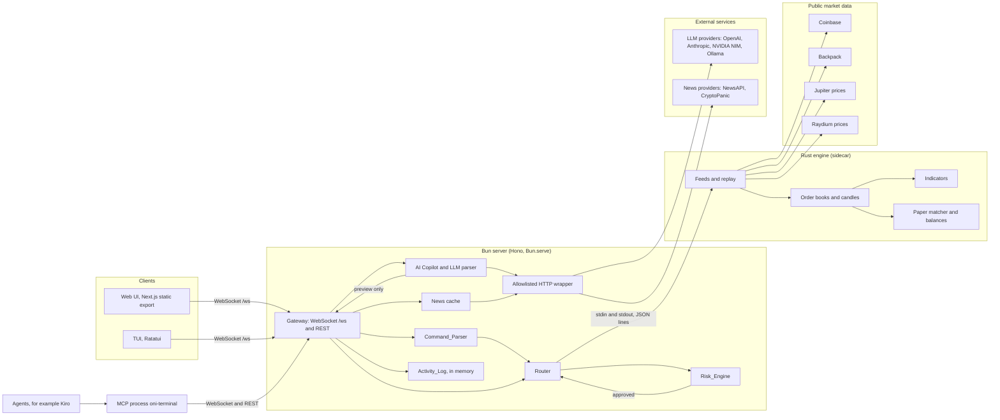
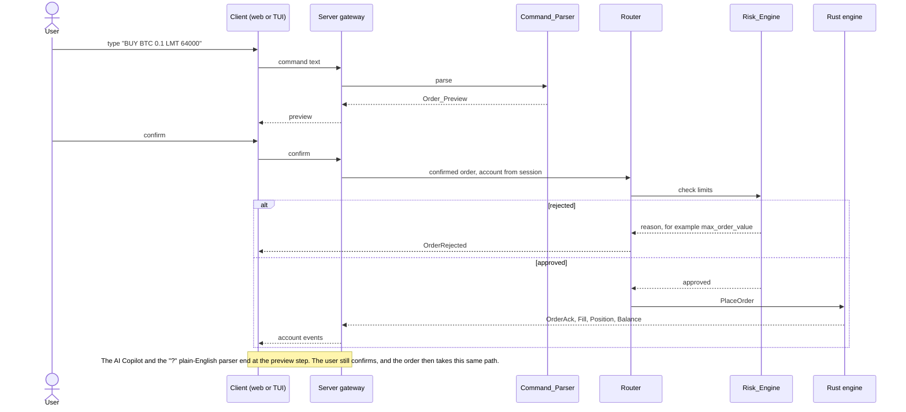

<div align="center">


# ONI 鬼

**A crypto paper-trading terminal for fast order entry, on the web and in your terminal.**


</div>

## What is Oni

Oni is a **paper-trading** terminal built for the Kiroween 2026 hackathon (Frankenstein category). It stitches a Next.js web UI, a Ratatui terminal UI, a Bun server, and a native Rust engine into one product. No real orders are placed and no real money is used.

Both clients show the same panels (chart, order book, trades, order ticket, positions and orders, watchlist, news) and talk to one Bun server. The server runs the Rust engine as a sidecar process. The engine owns market data, order books, candles, indicators, the paper matcher, and each account's P&L and paper balance.

There is **no database**. Orders, fills, and rejections live in an in-memory Activity_Log, and every account resets when the engine restarts. Replay mode and the guest account need no API keys and no wallet.

## Contents

- [Features](#features)
- [Architecture](#architecture)
- [Quick start](#quick-start)
- [Configuration](#configuration)
- [Keyboard and mouse](#keyboard-and-mouse)
- [Command bar](#command-bar)
- [AI Copilot and local models](#ai-copilot-and-local-models)
- [Accounts and sign-in](#accounts-and-sign-in)
- [MCP server](#mcp-server)
- [Testing](#testing)
- [Deploy on Render](#deploy-on-render)
- [TUI downloads](#tui-downloads)
- [Recording fixtures](#recording-fixtures)
- [Safety rules](#safety-rules)
- [Project structure](#project-structure)
- [License](#license)

## Features

**Trading**

- Ten symbols: `BTC-USD`, `ETH-USD`, `SOL-USD`, `BNB-USD`, `XRP-USD`, `DOGE-USD`, `JUP-USD`, `WIF-USD`, `BONK-USD`, `PEPE-USD`.
- Market, limit, stop, and TWAP orders. Every typed, plain-English, or AI order shows a preview that you confirm before it is placed.
- A paper balance per account (`STARTING_BALANCE` USD, default 100000). An order the account cannot pay for is rejected with `insufficient_balance`. There is no margin or borrowing.
- Positions with realized and unrealized P&L.

**Market data**

- Six timeframes: `1m 5m 15m 1h 4h 1d`. Chart types: candles, line, area, and Heikin-Ashi. Indicators: EMA, VWAP, Bollinger Bands, RSI, ATR.
- Four venues:

| Venue | Kind | Data |
|---|---|---|
| Coinbase | CEX | Public WebSocket and REST market data |
| Backpack | CEX | Public WebSocket and REST market data (USDC pairs shown as USD) |
| Jupiter | DEX | Prices only. Paper orders fill against a Synthetic_Book built around the price |
| Raydium | DEX | Prices and pool TVL only. Same Synthetic_Book fills |

- Binance and Bybit appear as disabled "coming soon" tabs.
- `DATA_MODE=replay` (recorded fixtures, no keys) is the default. With `DATA_MODE=live`, `LIVE_VENUES` (comma list of `coinbase,backpack,jupiter,raydium`, default all four) picks the feeds. `LIVE_VENUE` with one value is still accepted as an alias.
- News from NewsAPI (local development) or CryptoPanic (hosted).

**AI**

- Web AI Copilot: a chat with a "thinking" indicator and four actions: Analyze, Place trade, Create strategy, and Scan opportunities.
- Plain-English orders: start the command bar text with `?`.
- Providers: OpenAI, Anthropic, NVIDIA NIM, and Ollama (with local model discovery).
- The AI only suggests. Its output becomes a preview that you confirm. It never places an order.

**Interfaces**

- Web UI (Next.js static export, red and black Oni theme): resizable IDE-style split panels (drag a divider, double-click to reset, sizes are remembered), a resizable console with a log under the command bar, exchange tabs, coin icons, and times shown in your local time zone.
- Terminal UI (Ratatui, Windows and macOS): seven pages, mouse and keyboard. It has no Copilot panel.
- MCP server for agents such as Kiro.
- Sign in with Phantom or Backpack through Sign In With Solana (sign-in message only), or trade on the shared guest account.

**Safety**

- Paper only, a read-only endpoint allowlist, one order path through the Risk_Engine, confirm before placing, and a kill switch. See [Safety rules](#safety-rules).

## Architecture



The engine reads Commands as JSON lines on stdin and writes Events as JSON lines on stdout. Logs go to stderr. The router is the only module that sends order Commands to the engine.

### Order flow



## Quick start

Requirements: [Bun](https://bun.sh) 1.4.4 and Rust 1.94 with `clippy` and `rustfmt`. On Windows the release builds use the MSVC toolchain.

1. Install dependencies.

   ```sh
   bun install
   ```

2. Generate the TypeScript protocol types from the Rust protocol crate.

   ```sh
   bun run gen:protocol
   ```

3. Build the engine and the TUI (release build).

   ```sh
   bun run build:engine
   ```

4. Start the server and the web dev server. Open <http://localhost:3000>.

   ```sh
   bun run dev
   ```

5. In a second terminal, start the TUI.

   ```sh
   bun run dev:tui
   ```

`bun run dev` starts the server (`ws://localhost:8080/ws`, `GET /health`) and the web dev server. It waits for `/health` before it starts the web server, and it loads `server/.env` when that file exists. Replay mode needs no keys, so `server/.env` is optional. To set options, copy `server/.env.example` to `server/.env` (gitignored) and fill in values locally.

| Script | What it does |
|---|---|
| `bun run dev` | Server and web dev server |
| `bun run dev:server` | Server only |
| `bun run dev:web` | Web dev server only |
| `bun run dev:tui` | TUI against `ws://localhost:8080/ws` |
| `bun run build:engine` | Release build of the `engine` and `tui` crates |
| `bun run gen:protocol` | Regenerate `shared/protocol/*.ts` (never edit those files by hand) |
| `bun run icons` | Download coin icons into `web/public/coins/` (needs network) |
| `bun run check` | Full check, see [Testing](#testing) |
| `bun run bench:latency` | Server and engine in replay mode, prints p50 and p95 latency |
| `bun run --cwd web build` | Static export of the web UI |

`ENGINE_PATH` defaults to `rust/target/release/engine` (`.exe` on Windows). The web UI reads `NEXT_PUBLIC_WS_URL` (`ws://localhost:8080/ws`) and `NEXT_PUBLIC_API_URL` (`http://localhost:8080`), and `ALLOWED_ORIGINS` must include the web origin (default `http://localhost:3000`).

### Web pages

`/` (Trade), `/dashboard`, `/markets`, `/copilot`, `/portfolio`, `/logs`, `/settings`, and `/pair` (TUI pairing). `/backtest` exists as a "not built yet" placeholder.

## Configuration

Names only. Copy `server/.env.example` to `server/.env` and fill in values locally. An empty value counts as unset and selects the default. "Secret" means never log it, never commit it, and set it only through the environment (or the Render dashboard).

| Variable | Secret | Default | Purpose |
|---|---|---|---|
| `PORT` | no | `8080` | HTTP and WebSocket port |
| `ENGINE_PATH` | no | `rust/target/release/engine` | Path to the engine binary |
| `DATA_MODE` | no | `replay` | `replay` or `live` |
| `REPLAY_FIXTURE` | no | `demo.jsonl` | Fixture in `fixtures/` for replay mode |
| `REPLAY_SPEED` | no | `1` | Replay speed, 1 to 50 |
| `LIVE_VENUES` | no | all four | Live feeds (`coinbase,backpack,jupiter,raydium`) when `DATA_MODE=live` |
| `LIVE_VENUE` | no | unset | Single-venue alias for `LIVE_VENUES` |
| `ALLOWED_ORIGINS` | no | `http://localhost:3000` | Browser origins allowed on `/ws` and the auth routes |
| `WEB_URL` | no | first `ALLOWED_ORIGINS` entry | Web UI origin for pairing links. Must be in `ALLOWED_ORIGINS` |
| `KILL_SWITCH` | no | `false` | `true` rejects every new order on every account |
| `SESSION_SECRET` | yes | random per process | HMAC key for session tokens. Required in production, at least 32 bytes |
| `NODE_ENV` | no | unset | `development`, `production`, or `test` |
| `STARTING_BALANCE` | no | `100000` | Starting paper balance in USD (1000 to 100000000) |
| `BALANCE_SLIPPAGE_BPS` | no | `100` | Slippage allowance in the balance check |
| `DEX_*` | no | see `server/src/config.ts` | Synthetic_Book tuning for Jupiter and Raydium (`DEX_LEVELS`, `DEX_SPREAD_BPS`, `DEX_STEP_BPS`, `DEX_LEVEL_NOTIONAL`, `DEX_MAX_DEVIATION_PCT`) |
| `JUPITER_POLL_MS`, `RAYDIUM_POLL_MS` | no | engine default | Poll intervals for the DEX price feeds |
| `JUPITER_API_KEY` | yes | unset | Optional. Raises the Jupiter Price API rate limit. Sent only to that API |
| `LLM_PROVIDER` | no | first available of `ollama`, `openai`, `anthropic`, `nvidia` | Default AI provider |
| `OPENAI_API_KEY` | yes | unset | Enables OpenAI |
| `OPENAI_MODEL` | no | built-in | OpenAI model override |
| `ANTHROPIC_API_KEY` | yes | unset | Enables Anthropic |
| `ANTHROPIC_MODEL` | no | built-in | Anthropic model override |
| `NVIDIA_API_KEY` | yes | unset | Enables NVIDIA NIM |
| `NVIDIA_MODEL` | no | built-in | NVIDIA NIM model override |
| `NVIDIA_BASE_URL` | yes | NVIDIA hosted endpoint | NVIDIA NIM base URL (a URL can carry credentials) |
| `OLLAMA_BASE_URL` | yes | `http://127.0.0.1:11434` | Ollama base URL |
| `OLLAMA_MODEL` | no | `gemma4` | Default Ollama model |
| `AI_RATE_PER_MIN` | no | `6` | AI requests per connection per minute |
| `AI_DAILY_CAP` | no | `500` | AI provider calls per UTC day (OpenAI, Anthropic, NVIDIA) |
| `NEWS_PROVIDER` | no | by `NODE_ENV` and available key | `newsapi`, `cryptopanic`, or `none` |
| `NEWS_API_KEY` | yes | unset | NewsAPI key (development only) |
| `CRYPTOPANIC_API_KEY` | yes | unset | CryptoPanic token (hosted) |
| `CRYPTOPANIC_PLAN` | no | `developer` | `developer`, `growth`, or `enterprise` |
| `NEWS_TTL_SECONDS` | no | `900` | News cache time, 300 to 3600 |
| `NEWS_ALLOW_NEWSAPI_IN_PRODUCTION` | no | `false` | Allow NewsAPI in production (its terms may forbid it) |
| `TERMINAL_TOKEN` | yes | unset | MCP process only: a session token for a wallet account |
| `TERMINAL_URL` | no | `http://localhost:8080` | MCP process only: the Oni server address |

There is no `DATABASE_URL`. An invalid value makes the server log the variable name (never the value) and exit with status 1.

## Keyboard and mouse

Bindings live in `shared/keymap.json`, per client. The mouse works on every panel.

| Action | Web | TUI |
|---|---|---|
| Timeframe | `1` to `6` (1m, 5m, 15m, 1h, 4h, 1d) | `<` and `>` (previous and next) |
| Pages | `Alt+1` to `Alt+8` | `1` to `7` |
| Next or previous symbol | `Tab` / `Shift+Tab` | `Tab` / `Shift+Tab` |
| Next venue | `V` | `V` |
| Next AI provider | `G` | `G` |
| Next AI model | | `M` |
| Focus the AI Copilot | `C` | |
| Buy / sell | `B` / `S` | `B` / `S` |
| Flatten all positions | `F` | `F` |
| Cancel all orders | `X` | `X` |
| Toggle EMA / VWAP / Bollinger / RSI / ATR | `E` / `W` / `O` / `R` / `T` | `E` / `W` / `O` / `R` / `T` |
| Focus the command bar | `:` | `:` |
| Chart zoom and pan | `+` `-` `Left` `Right` | `+` `-` `Left` `Right` |
| Chart type | chart type control (candles, line, area, Heikin-Ashi) | `l` toggles line and candles |
| Cycle ticket order type | | `t` |
| Pair with the web UI | | `P` |
| Help | `F1` | `F1` |
| Quit | | `Q` |

TUI pages: **[1] Trade**, **[2] Book**, **[3] Positions**, **[4] Orders**, **[5] Watchlist**, **[6] News**, **[7] Config**. Web pages are listed under [Quick start](#web-pages) and follow the sidebar order on `Alt+1` to `Alt+8`.

## Command bar

Keywords are case-insensitive. Short symbols such as `BTC` resolve to `BTC-USD`. Every command produces a preview that you confirm.

```text
BUY BTC 0.1                     market order
BUY BTC 0.1 LMT 64000           limit order
SELL ETH 2 STP 3000             stop order
SELL SOL 50%                    50% of the current SOL position, rounded down to a lot
BUY BTC-USD 1 TWAP 4 60         4 slices, 60 seconds apart
CANCEL ALL                      cancel every open order of the account
FLAT                            flatten all positions
? buy a little ETH at 3000      plain-English order (needs an AI provider)
```

TWAP takes 2 to 20 slices and 5 to 3600 seconds between slices. You confirm one preview, then the router sends one market child order per slice, each through the Risk_Engine. Remaining children are cancelled on disconnect, account change, engine restart, a rejected child, or cancel.

## AI Copilot and local models

The web Copilot panel (and the `/copilot` page) lets you chat, **Analyze** the selected symbol, **Place trade** (which produces a preview), **Create strategy**, and **Scan opportunities**. Pick the provider with `G` or in the panel. Headlines and other external text sent to a model are treated as untrusted data.

The TUI has no Copilot. `G` and `M` still choose the provider and model used by `?` plain-English orders.

### Ollama

1. Install [Ollama](https://ollama.com) and start it.
2. Pull a model, for example `ollama pull gemma4`.
3. Optionally set `OLLAMA_BASE_URL` and `OLLAMA_MODEL` in `server/.env`. Use `127.0.0.1`, not `localhost`, on Windows.

Oni lists the installed models from Ollama and re-checks every 30 seconds. Choose a model in the web Copilot panel (a picker with a "None" option) or on the Settings page, or cycle with `M` in the TUI. Ollama shows as unavailable when no model is installed. A hosted server cannot reach your local Ollama.

## Accounts and sign-in

- **Guest.** Everyone without a valid session shares one `guest` account. No wallet or keys needed.
- **Wallet (web).** Sign in with Phantom or Backpack through Wallet Standard and Sign In With Solana. The wallet signs one thing, the sign-in message ("Sign in to Oni paper trading. This signature does not authorize any transaction."). It never signs or sends a transaction, and the server never contacts a Solana RPC. Your account is `w_<address>`. The session token lasts 24 hours.
- **TUI pairing.** Press `P` in the TUI. It shows an 8-character code and a link `<web url>/pair/?code=...` that is valid for 5 minutes. Open the link, sign in, and confirm the code. The token is saved to `haunted-terminal/session.json` in the per-user config directory (mode 0600 on Unix).
- `tui --guest` ignores the saved sign-in. `tui --logout` revokes the token, deletes the file, and exits. In a release download the binary is named `oni-tui`.

## MCP server

Registered in `.kiro/settings/mcp.json` as `oni-terminal` and started with `bun run server/src/mcp/main.ts`. It is a client of a running Oni server, so start the server first.

| Tool | What it does |
|---|---|
| `get_quote` | Best bid, best ask, spread, and last trade price for a symbol |
| `get_candles` | Recent OHLCV candles for a symbol and timeframe |
| `get_positions` | Positions and P&L of the MCP connection's paper account |
| `preview_order` | Parses an order command and returns its preview. Places nothing |
| `place_paper_order` | Submits an order through the same router and risk checks as every other order |

The settings file auto-approves the four read-only tools, so `place_paper_order` asks for approval. Without `TERMINAL_TOKEN` the MCP process uses the guest account. For a wallet account, set a session token in `TERMINAL_TOKEN` in the environment that launches Kiro. Never write it into `mcp.json`.

## Testing

```sh
bun run check
```

It runs, in order: `cargo fmt --check`, `cargo clippy` with `-D warnings`, `cargo test` for the workspace, an engine build, `tsc --noEmit` for `shared`, `server`, and `web`, and `bun test`. It needs no database, API key, or network. Rust properties use proptest and TypeScript properties use fast-check. Tests use mock servers and recorded fixtures and never contact a real exchange, news host, LLM host, or wallet.

## Deploy on Render

`render.yaml` is a Render Blueprint with two services:

| Service | Type | Runs |
|---|---|---|
| `oni-server` | Docker web service (free plan, health check `/health`) | Bun server and Rust engine, built from `Dockerfile` |
| `oni-web` | Static site | Next.js static export from `web/` |

1. Push the repository to GitHub.
2. In Render choose **New > Blueprint**, select the repository, and apply `render.yaml`.
3. Enter the values marked `sync: false` in the dashboard (API keys). Render generates `SESSION_SECRET`.

The Blueprint runs the hosted server in replay mode with `NEWS_PROVIDER=cryptopanic`. If a service name is taken, Render adds a suffix to the URL. Then update `ALLOWED_ORIGINS` and `WEB_URL` on `oni-server`, update `NEXT_PUBLIC_WS_URL` (`wss://<server-host>/ws`) and `NEXT_PUBLIC_API_URL` (`https://<server-host>`) on `oni-web`, and redeploy `oni-web`. The TUI defaults to `wss://oni-server.onrender.com/ws`; use `--server` for other hosts.

On the free plan the server sleeps after a period without traffic and takes a while to wake. A restart resets the engine, so every paper account resets. There is no database service.

## TUI downloads

Each tagged release (`v*`) has `oni-tui-windows-x64.zip`, `oni-tui-macos-universal.tar.gz`, and `SHA256SUMS.txt`. Each archive unpacks to `oni/` with `oni-tui`, `oni-engine`, and `fixtures/`. The binaries are not code-signed.

Verify: `Get-FileHash .\oni-tui-windows-x64.zip -Algorithm SHA256` (Windows) or `shasum -a 256 oni-tui-macos-universal.tar.gz` (macOS), and compare with `SHA256SUMS.txt`. Run `.\oni\oni-tui.exe` (Windows) or `./oni/oni-tui` (macOS).

| Flag | Meaning |
|---|---|
| `--server <URL>` | WebSocket URL of the Oni server (`ws://` or `wss://`). Default: the hosted server |
| `--guest` | Use the guest account and ignore any saved sign-in |
| `--logout` | Revoke the saved token, delete it, and exit |
| `--version` | Print the version |

- **macOS Gatekeeper** blocks unsigned downloads. Run `xattr -d com.apple.quarantine ./oni/oni-tui ./oni/oni-engine`, or right-click the file and choose **Open**.
- **Windows SmartScreen** may warn. Click **More info**, then **Run anyway**.

## Recording fixtures

`engine record` captures one venue's public feed into a fixture that replay mode plays back.

```sh
cargo run --manifest-path rust/Cargo.toml -p engine --release -- record \
  --venue backpack --symbols BTC-USD,ETH-USD,SOL-USD --out fixtures/backpack-live.jsonl
```

| Flag | Meaning |
|---|---|
| `--venue coinbase\|backpack` | Feed to record (default `backpack`) |
| `--symbols` | Comma-separated internal symbols |
| `--out <path>` | Required output file |
| `--duration <s>` | Stop after this many seconds (default 300, at most 86400) |
| `--max-messages <n>` | Stop after this many lines |
| `--force` | Replace an existing output or leftover `.partial` file |

Lines go to `<out>.partial` and are renamed when the run ends. Ctrl-C is not handled; use `--duration` or `--max-messages`. To regenerate the demo fixture, run the engine's `synth` subcommand: `cargo run --manifest-path rust/Cargo.toml -p engine -- synth --out fixtures/demo.jsonl`.

## Safety rules

1. **Paper only.** The matcher fills paper orders against live public market data or replayed fixtures. No funds move, no wallet transaction is built or signed, and there is no testnet.
2. **Endpoint allowlist.** Market data is read-only and limited to public, unauthenticated Coinbase and Backpack endpoints, `GET api.jup.ag/price/v3`, and `GET api-v3.raydium.io/mint/price` and `/pools/info/mint`. The server also calls its news and LLM hosts, only through the allowlisted HTTP wrapper `server/src/net/http.ts` (Rust twin: `rust/crates/engine/src/feed/allowlist.rs`). No authenticated, trading, swap, or transaction endpoint is ever called.
3. **One order path.** Every order, from the web UI, the TUI, the plain-English parser, the AI Copilot, or the MCP server, goes through `server/src/router.ts` and the Risk_Engine before the engine sees it.
4. **Confirm before placing.** Command bar, plain-English, and AI orders produce a preview. The router accepts them only after the same client confirms it on the same account.
5. **The LLM never trades.** LLM output is untrusted input. It is validated with Zod and parsed by the normal command parser, so it can only produce a preview.
6. **Risk limits and the kill switch.** Limits have no bypass. `KILL_SWITCH=true` rejects every new order on every account. Rejection reasons include `kill_switch`, `rate_limit`, `max_open_orders`, `price_band`, `max_order_value`, `max_position`, and `insufficient_balance`.
7. **Secrets in the environment only.** `.env` is gitignored. Secrets are never logged, returned in responses (except the one response that issues a session token), or committed.
8. **Accounts come from the verified session.** The server sets the account on every order from the session of the requesting connection, never from client input, MCP arguments, or LLM output.

## Project structure

```text
.
├── rust/                  Cargo workspace
│   └── crates/
│       ├── protocol/      Command and Event types, TypeScript generation
│       ├── engine/        Sidecar: feeds, books, candles, indicators, matcher, balances
│       └── tui/           Ratatui terminal client
├── server/                Bun + Hono server (gateway, router, risk, parser, AI, news, MCP)
├── web/                   Next.js web UI (static export)
├── shared/                Generated protocol types and keymap.json
├── fixtures/              Replay fixtures
├── scripts/               dev.ts launcher, coin icon downloader
├── .github/workflows/     CI and release workflows
├── .kiro/                 Specs, steering, hooks, MCP settings
├── Dockerfile             Server and engine image
└── render.yaml            Render Blueprint
```

## License

Released under the [MIT License](LICENSE).
